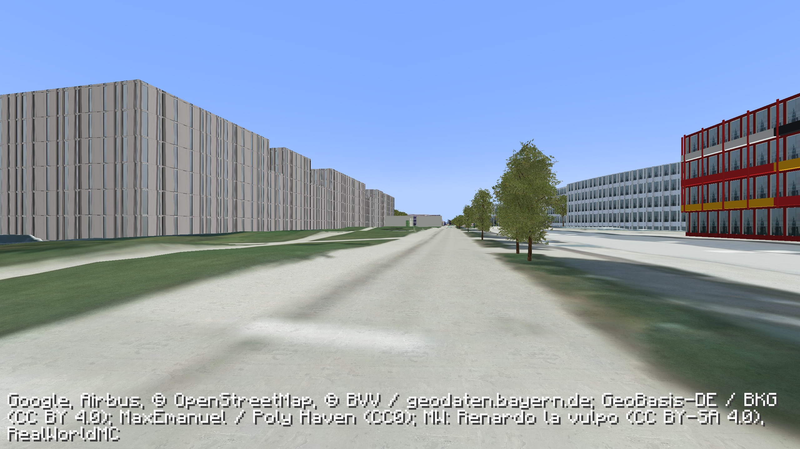

# Minecampus

**Actual Minecraft Java at TUM Garching.**

The native version uses **Minecraft Java 1.21.1, Fabric, and [RealWorldMC](https://github.com/Teddy563/realworldmc)** to combine the real game with streamed, textured real-world terrain. Minecraft supplies its own Steve/player skins, models, blocks, inventory, crafting, combat, food, mobs, TNT and sound assets.

## Install and play

Install the official Minecraft Launcher and sign in with a Java Edition account. With Python 3 and Node.js 22+ installed, close the launcher and run:

```sh
python3 scripts/minecraft.py install
```

Reopen the launcher, select **Installations → Minecampus — TUM Garching**, and press **Play**. Choose the official **Steve** under Skins if you want Steve specifically. Complete the mod's masked map setup, then create a world with **World Type: TUM Garching — Minecampus**. Enable commands for the campus helper functions.

**Map access is required.** New Google projects with German/EEA billing cannot request Photorealistic 3D Tiles directly. The setup also supports eligible Cesium ion access to Google's 3D tiles. Read the [complete native setup and play guide](minecraft/README.md) before creating the world.

```sh
python3 scripts/minecraft.py build   # creates an importable .mrpack in dist-minecraft/
python3 scripts/minecraft.py doctor  # local readiness, without printing credentials
python3 -m unittest discover -s minecraft/tests
```

The fixed campus origin is **48.265° N, 11.671° E**. You receive real Minecraft starter supplies; `/function minecampus:help` lists mode, time, kit and animal commands. Use normal Minecraft controls and F5 for third person.

## Walking-quality preview — goal unfinished

The newer [Exterior Preview 0.5](minecraft/exterior/PREVIEW-0.5.md) is available as a separate installation. It adds IAS and UYA exterior detail, the former Mensa terrace frontage, photographic survey walls, finer terrain and ground materials, Telefonzentrale windows, and the current COS exterior with local site grading, mapped paths, benches, bicycle stands and an inferred planting bed. The normal installer below remains on 0.4.0; the preview installer copies your existing world into its own game directory.

Version 0.4.0 is a playable preview toward a better walking-height campus. Its 600 × 600 m survey layer combines DGM1 terrain, DOP20 aerial imagery, inferred tree/canopy instances, and six detailed building components covering Galileo, the main MW structures and the colourful Graduate School. The promenade's three grass-roof structures remain. Elevated flight retains the photographic mesh.

The packaged preview passed native Minecraft captures, terrain TNT excavation, gravity/landing and preservation checks for player blocks and recorded damage. **Those checks do not establish a finished photorealistic campus.** Unreconstructed façades and vegetation attached to their protected photo meshes still show substantial source artifacts. Window, roof and vegetation details are approximations. [Quality goal and remaining work](minecraft/exterior/QUALITY-GOAL.md) · [Actual captures and validation](minecraft/exterior/VALIDATION.md).



RealWorldMC's collision terrain approximates its photo mesh. Scanned buildings have no measured interiors, vanilla ores/caves are not generated in the campus dimension, and night dims daytime imagery. Starter materials support crafting and farming; the Nether and End use vanilla generation. Upstream public streamed-world hosting is not ready-made. LAN play is a test path, not a verified feature of this pack yet.

## Earlier browser prototype

The Three.js browser game remains in this repo as an earlier, independent prototype. It uses procedural imitation characters, textures, gameplay and sounds. It is **not actual Minecraft**. Its Bavarian aerial mesh is a 2.5D survey with poor ground-level facades; it should not be presented as a photorealistic street-level campus. [Prototype documentation](BROWSER-PROTOTYPE.md).

`npm run dev` still runs that browser prototype. Use the native installation above for actual Minecraft.

## Sources and assets

[Research and architecture](RESEARCH.md) · [Third-party notices](THIRD_PARTY.md) · [Native pack source](minecraft/)

The public repository does not bundle Minecraft's proprietary game assets. The official launcher obtains those for your authenticated game installation. The Minecampus add-on is MIT; RealWorldMC and Fabric API are Apache-2.0; map content has separate provider terms.
