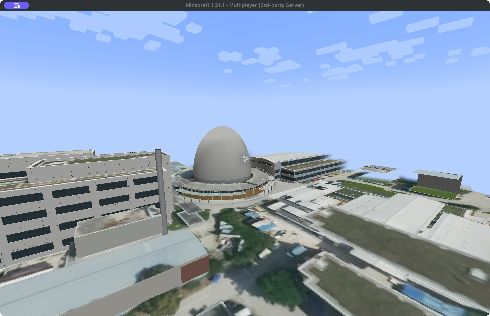
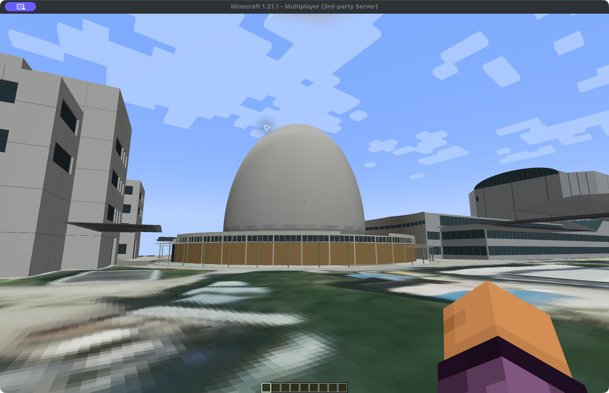
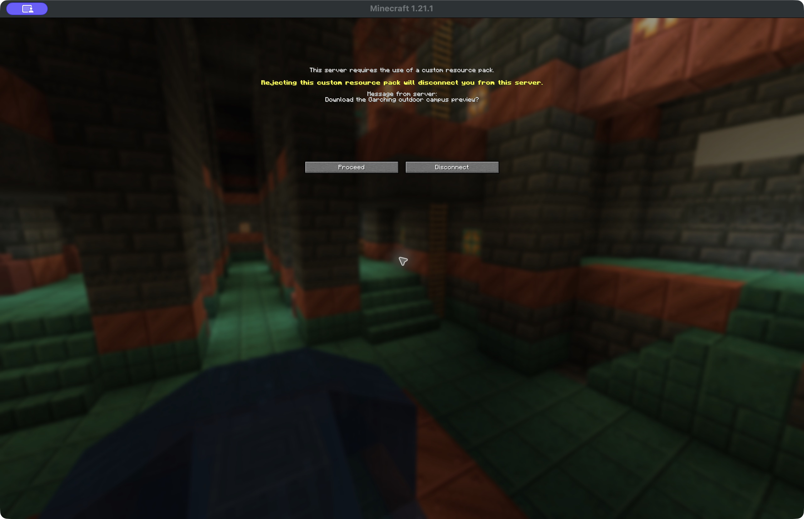

# Realistic campus with vanilla-client joining

Research date: 2026-10-31. Status: outdoor sector rendered and joined by two vanilla clients on a local test server; no public vanilla server yet.

The intended guest flow is **Minecraft Java → Multiplayer → server address → accept the server resource pack**. This avoids a separately installed mod, launcher bundle or guest map key. It still downloads campus data through Minecraft. Windows, macOS and Linux clients must use the same supported Java Edition version.

The earlier assertion that an unmodified client necessarily requires rebuilding the campus out of cubes was too broad. Resource packs can override core shaders and encode arbitrary textured meshes. This offers a plausible rendering port; it does not automatically port RealWorldMC collision, terrain edits or lighting.

## Existing implementations

- [Godlander/objmc](https://github.com/Godlander/objmc), MIT: converts OBJ geometry into model faces plus textures that encode vertices, decoded by resource-pack shaders. Its documentation recommends optimizing face counts, warns about culling, and describes block models as more efficient than entity models. This is the basis of our probe.
- [JagerMeistars/obj-cubed](https://github.com/JagerMeistars/obj-cubed): a maintained fork with additional authoring features. Its current formats target newer Minecraft versions; version matching is necessary.
- [3DEngine](https://resourcepack.ai/docs/3d-engine): documents importing OBJ/GLB/glTF meshes into a server plugin and sending a generated resource pack to vanilla players. Its documented target is Minecraft 26.3, so it is not a drop-in plugin for this project's 1.21.1 setup. We have not installed or benchmarked it. It demonstrates an existing implementation of the desired distribution approach.
- [Paper's server properties](https://docs.papermc.io/paper/reference/server-properties/#resource-pack): document the resource-pack URL, hash, prompt and required-pack settings. Hosting a reachable server and pack URL remains necessary.

These sources establish the technique and joining mechanism, not performance for our campus. Core shader overrides also need a fixed supported Minecraft version; changing versions or combining other core shader packs may break them.

## Outdoor Garching preview

The active preview is a **275 × 175 metre outdoor sector around Atom-Ei and MLZ**. The isolated warehouse demo worlds have been deleted. No Mensa interior is included. The installed full Fabric campus remains separate.

`scripts/build-vanilla-campus-scene.py` clips the existing campus meshes and photographic terrain/roof textures to this sector, then exports 185,849 triangles in 183 item displays. The pack is **15,736,568 bytes (15.7 MB)**. It retains the asset attribution in `THIRD_PARTY.md`; no Google tiles, credentials or Minecraft binaries are bundled.

The converter uses the pinned objmc commit `940ed38dd0ca87739aa7fadd7ff5924aaf4227de` through the shared helpers in `build-vanilla-campus-probe.py`. That older script remains a diagnostic converter, not the active world. Java **1.21.1** is required. Dependencies are generated `dist-minecraft/exterior` assets, Python with NumPy, Pillow and Tkinter, plus network access for the pinned converter.

```sh
.cache/geodata-venv/bin/python scripts/build-vanilla-campus-scene.py
```

Outputs in `dist-minecraft/vanilla-campus/` are `Minecampus-outdoor-resourcepack.zip`, `Minecampus-outdoor-datapack.zip`, and `validation.json`. The datapack preserves campus coordinates and generates an approximate one-metre terrain collision grid. Building walls and roofs do not yet have collision; TNT does not destroy the displayed meshes.

### Verified locally on 2026-10-31

Two separate unmodified Java 1.21.1 clients joined the same dedicated server on one Mac. A fresh client with no manually installed resource pack received the prompt, accepted it, downloaded the outdoor pack and visibly rendered Atom-Ei and surrounding buildings. The first client's reconnect reused its cached pack. Server logs confirmed both players online together.

The second player landed at `(210.5, 64, -47.5)` and walked to approximately `(212.95, 64, -50.78)` with `OnGround=1` before and after. This checks a short outdoor route, not all terrain. The atlas loaded at 8192 × 4096 with no client ERROR entries. An aerial F3 snapshot showed 37 FPS at 2560 × 1600 on an M1 Max, render distance 10; this is a single observation, not a performance benchmark. Full-campus performance and Windows/Linux rendering remain untested.







### Repeat the local server check

After reviewing the Minecraft EULA, run the isolated fixture with Java 21:

```sh
python3 scripts/run-vanilla-campus-lab.py --java /path/to/java21 --accept-eula
```

Its default metadata path is the official Minecraft installation on macOS; Windows/Linux hosts must pass `--metadata /path/to/versions/1.21.1/1.21.1.json`. The fixture downloads and verifies the official server JAR. Join `127.0.0.1:25579` in vanilla 1.21.1 and accept the pack. Type `stop` in the host terminal to stop it.

The server and pack HTTP endpoint bind only to loopback. Offline identities are used only for this isolated test. Do not expose this fixture publicly: remote deployment needs authenticated accounts, reachable hosting and a public pack URL. The fixture uses an independent generated world under `.cache/vanilla-campus-probe/server-lab/outdoor-world`.

For a manual datapack installation, use a new disposable flat creative world with terrain top at Y=60, enable the resource pack and install the datapack. Run `/reload`, then `/function minecampus_scene:setup`; this force-loads the sector and schedules terrain plus display placement. Teleport to `210 65 -48`. `/function minecampus_scene:clear` removes display entities only; the generated barriers and force-loaded chunks remain. Prefer the isolated fixture rather than installing into a personal save.

**Remaining visual limitations:** this is a bounded sector, with clipped edges and incomplete peripheral buildings. Vegetation meshes are omitted, photographic ground is blurry at walking height, and lighting differs from the Fabric renderer. The preview is useful evidence for vanilla delivery, not a finished campus replacement.

## Campus-scale implementation path

The main exterior manifest has 483 tiles containing approximately **3,058,064 triangles**: 987,348 ground, 700,174 reconstruction and 1,370,542 vegetation triangles. This excludes auxiliary roof/collision streams and distant streamed imagery. The existing source contains about 434 MiB of raw RGBA texture data with substantial duplication. These figures are input measurements, not expected resource-pack sizes or GPU benchmarks.

1. Local outdoor rendering and two-client server delivery now pass. Next, test remote authenticated joining and rendering on Windows/Linux.
2. Compare efficient chunk-sized block meshes against item displays, preserving the recognizable buildings and textures. Deduplicate textures, simplify vegetation and reduce distant detail. Benchmark a representative campus area before committing to the whole scene.
3. Generate server-side terrain/collision and handle construction, breaking and TNT damage so visible meshes stay consistent with gameplay. Vanilla inventory, crafting, food, mobs, combat and sound already come from Minecraft; custom campus geometry interaction does not.
4. Package only redistributable assets into a bounded campus, host the resource pack and authenticated Minecraft server, and test actual remote joining across the supported operating systems. Avoid guest credentials by using the open campus layer instead of Google/Cesium streaming.

This is a feasible direction to investigate, not a completed replacement for the current Fabric release. There is no new public vanilla server address yet.
