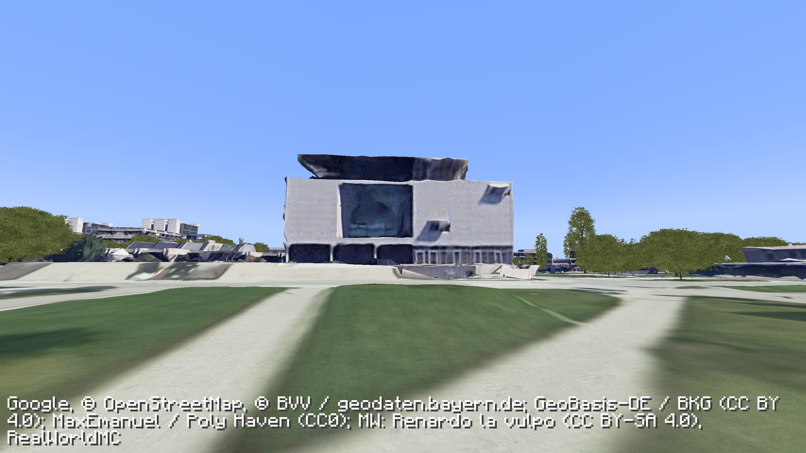
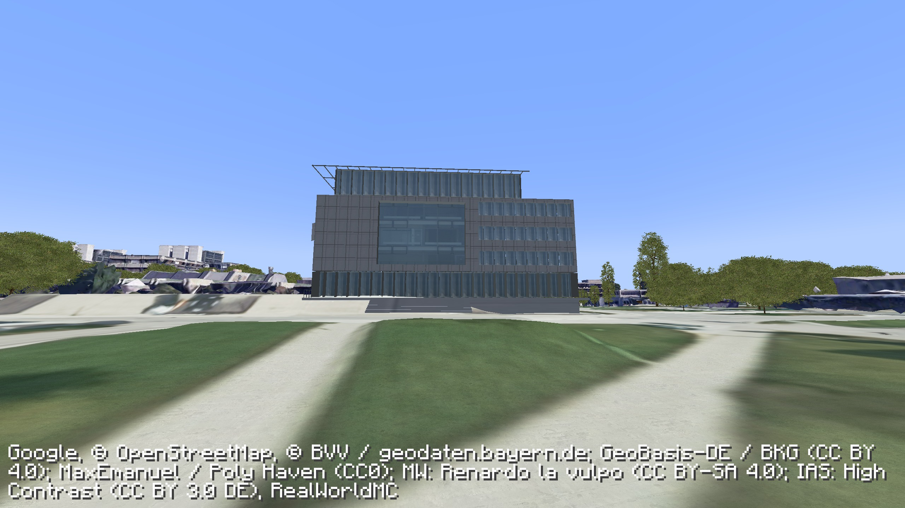

# IAS exterior development — 23 October 2026

This is verified development progress toward the unfinished campus realism goal. The installed/published playable preview remains 0.4.0.

The IAS envelope and roof come from BVV LoD2 component `DEBY_LOD2_8486677`. The recessed south atrium, glazed entrance storey, raised terrace and steps, folding side screens and rooftop sunshade are reconstructed from [Fritsch + Tschaidse’s project reference](https://fritsch-tschaidse.de/en/projects/tu-munich-institute-for-advanced-study.html) and [High Contrast’s 2013 photograph](https://commons.wikimedia.org/wiki/File:TU_M%C3%BCnchen_Garching_-_Institute_for_Advanced_Study.jpg). The photograph is CC BY 3.0 DE; cropped metal and glass materials are attributed in game and in the package. Panel, stair and opening dimensions remain approximations.

## Same native Minecraft camera

Both images use position `65 65 -157`, yaw `-166`, pitch `-8`, noon and full streaming readiness. They are full-frame captures, retaining provider credits.

Before, published 0.4.0:

After, development build:

The replacement improves the building silhouette, window bands and entrance geometry. The neighbouring photographic structures still have severe artifacts. The new materials and rooftop screening also remain approximations; this comparison does not establish a finished photorealistic campus.

## Verification

The exact development JAR ran in the isolated native client with its own managed embedded service. Eight ground/aerial/TNT/promenade/source-limit/IAS captures completed. Native TNT excavation and restoration passed; gravity landed the player on surveyed ground at Y=65 and on the new IAS terrace at Y=67. Player blocks and recorded damage survived collision migration without extra damage records. The original user world remains byte-for-byte equal to its private backup.

The scene now contains 82 render tiles and seven detailed building components, alongside the same 734 canopy instances. Geometry validation checks binary lengths, finite positions, UV ranges and bounds. Exact hashes, counts and native assertion text are in [ias-development-validation.json](ias-development-validation.json).

The normal installer remains pinned to 0.4.0. This development pass is source-buildable, but has not replaced the user's installed preview. Next work must address the remaining coarse neighbouring façades and route continuity, while retaining the full-campus goal.
