# Survey-aligned photographic façades — 23 October 2026

This development pass improves building geometry and removes specific floating scan fragments in actual Minecraft Java. The overall realism goal remains unfinished. The installed and published playable preview is still 0.4.0; the changes below are in the source-buildable 0.5.0-dev artifact.

## First verified artifact: `7ebdfa0f…`

The sections through “Verification and limits” below describe the first artifact exactly. Later changes are recorded separately at the end.

## What changed

Eighty BVV LoD2 building envelopes are candidates for photographic wall reconstruction. The runtime projects the existing provider material onto each measured wall, choosing the closest source surface along its normal. A wall needs at least 80% observed coverage, no disconnected unfilled region and no fill extending more than two metres from observed pixels. A building switches only when acceptable walls account for at least half its wall area. Unsupported faces retain their original scan geometry.

In the verified native run, **56 buildings supplied acceptable walls; 24 retained their original meshes**. This is not 56 fully detailed architectural models. The survey fixes silhouettes and wall/roof edges; the original photography still determines visible detail. The seven separately reconstructed detailed building components, including IAS, remain distinct from these envelopes.

Roofs use public BVV geometry and DOP20 imagery. The package contains public survey surfaces, collision geometry and the projection code. Provider pixels are generated in memory through the existing configured client, retain provider credits, and are not packaged or saved by the projection pipeline. Unsupported or unavailable source material falls back to the original scene.

The vegetation detector now recognizes brown as well as green crowns, increasing the inferred count from 734 to 740. The source-limit camera exposed a missed autumn tree beside a low roof. A roof-aware foliage mask retires that old canopy without deleting the measured building beneath it. Finite wall-segment distance also removes stray original triangles around reconstructed building corners.

## Same native Minecraft camera

Position `150 65 -220`, yaw `-90`, pitch `0`, noon, after full streaming readiness. Both exports retain the complete framebuffer and its attribution.

Before this pass, with the prior IAS development build:

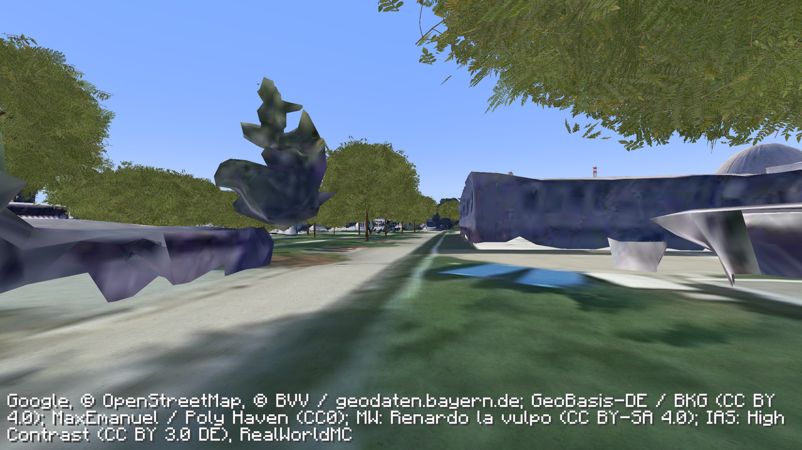

After:

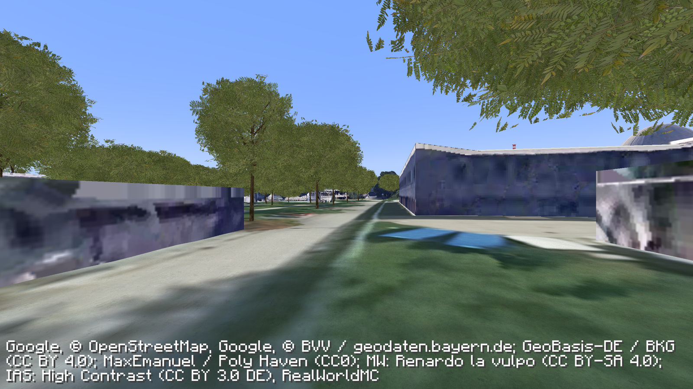

The floating canopy and the small triangle hanging beside the right-hand wall are gone. Native ray picks at their former screen positions now hit reconstructed vegetation and a survey-aligned façade. The shaded wall is still visibly blurry; this comparison does not establish finished realism.

The same pilot building from its north side, at `205 65 -238`, yaw/pitch `0 0`:

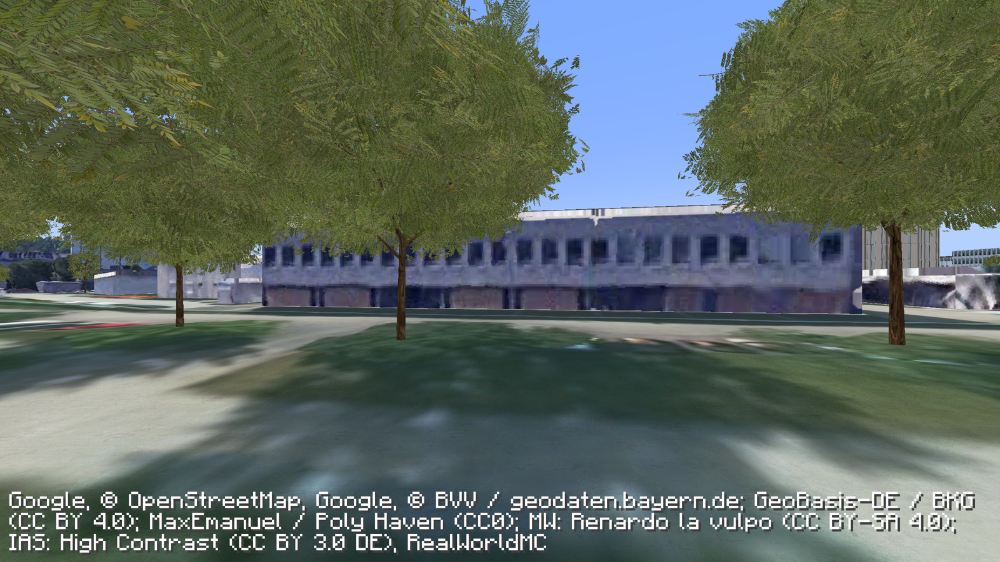

Window positions are more legible on this face, but the source remains low resolution at walking distance. No invented window grid or AI-generated image was substituted for missing photography.

## Verification and limits

The exact packaged JAR completed nine native ground/aerial/TNT/promenade/source-limit/IAS/photographic-façade captures. All five native assertions passed: scene readiness, player-edit preservation, TNT excavation/restoration and ground landing, IAS terrace landing, and landing on the survey roof supporting the pilot façade. That roof is at Y=72.264896 at the test point; the native one-metre collision grid lands the player at Y=72, within half a block.

All 19 service tests pass, including source-depth selection, incomplete coverage, openings, unsupported-face retention, corner ownership, save-datum translation, source-array immutability and roof-aware canopy removal. Generated binary geometry, texture lengths, finite positions, UV bounds, foliage masks and roof-height arrays pass validation. All 46 backed-up original world files remain byte-for-byte unchanged; the ephemeral session lock is excluded.

Exact artifact and framebuffer hashes, runtime acceptance records and native assertion text are in [photo-facades-development-validation.json](photo-facades-development-validation.json).

Remaining work includes sharper, source-supported façade detail, residual artifacts on rejected surfaces, site furniture and the fidelity of the separately reconstructed landmark materials. The imagery dates and surveyed geometry can also differ. These limitations are why this pass remains development evidence rather than a declaration that the campus is finished.

## Follow-up artifact: `d1c03a6e…`

This follow-up evaluates only the wall area above surveyed ground and accepts usable faces independently. The same per-face requirements remain: 80% observed photography, no unfilled region and at most two metres of filling. In the new native run, 79 of 80 buildings supplied at least one usable face. This count says nothing about complete building fidelity; unsupported faces remain visibly coarse. The former Mensa (`DEBY_LOD2_5284422`) now supplies photographed survey walls rather than being rejected because its survey foundation extends below surrounding terrain.

The tenth native viewpoint, `0 64.25 -216`, yaw/pitch `180 -5`, exposes the former Mensa approach. Newly generated chunks revealed visible source dirt filler in a protected margin beside the steep bank. Generation now normalizes that filler to invisible, mineable map material within survey coverage, preserving bedrock, water, unrelated regions and the source byte cache. Existing ordinary blocks remain protected; this is not a destructive old-save cleanup.

The overhang mask now includes shadowed green foliage and covers the whole guide cell before downsampling. The following same-camera comparison isolates these two cleanup changes in fresh worlds, after independent visible-face acceptance was already enabled:

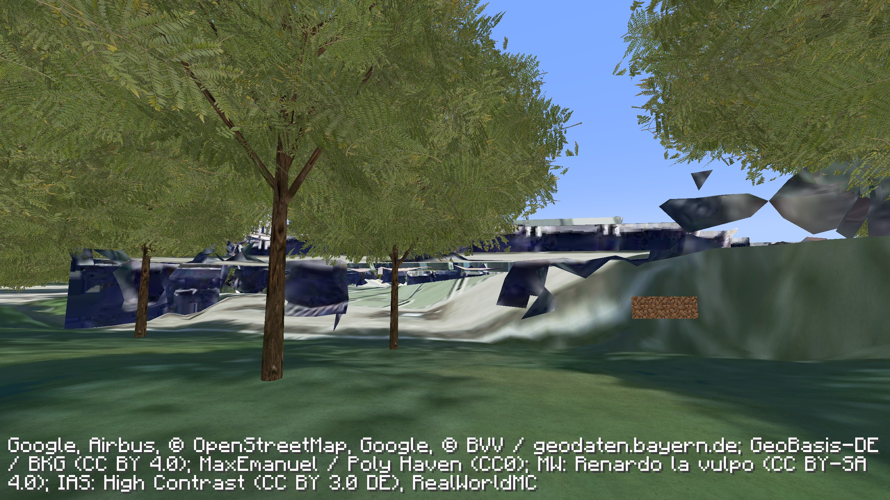

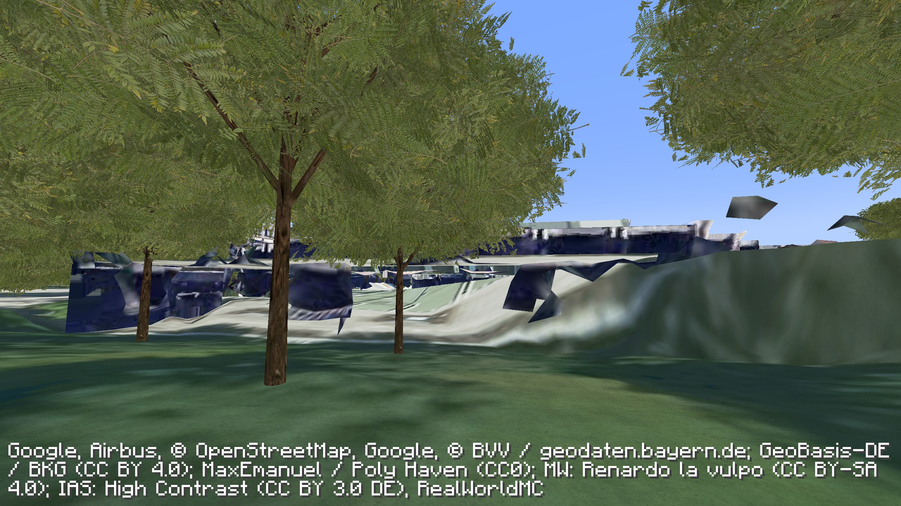

The exposed dirt patch is gone. At screen coordinate `(0.745, 0.615)`, native block picking changes from `minecraft:dirt` to invisible `earthcraft:map_dirt` at the same block `(10, 64, -231)`. At `(0.96, 0.40)`, the removed scan triangle now gives a sky miss. Other triangles remain, including the one hit at `(0.84, 0.43)`. This view still fails the realism goal and is deliberately retained as evidence of unfinished work.

The packaged follow-up passed all ten captures, all five native assertions, 21 service tests and geometry validation. All 46 backed-up original world files remain unchanged. The fresh-world collision migration changed zero proxies, so this run does not replace historical proof of migration on existing chunks. Exact artifact/frame hashes, coverage records, ray picks and native results are in [visible-facades-development-validation.json](visible-facades-development-validation.json). The installed/public preview remains 0.4.0.

## Former Mensa structural frontage: `cb804d81…`

The next close-up showed that a straight photographic sheet still failed to express the building’s concrete frame and recessed glazing. Five surveyed terrace faces now have eleven reference-informed concrete bays, with piers, beams, a shallow exterior apron, recessed glass divisions, low opaque panels and a rooftop maintenance railing. The broad face measures 43.03 m in BVV geometry and is divided into six bays; four stepped faces add five bays. The envelope lengths and elevations are surveyed. Pier dimensions, pane divisions and the 1.1 m recess are estimates from the [TUM exterior reference](https://www.ed.tum.de/ed/news-single-view-start/article/tum-ed-bezieht-alte-mensa-in-garching-nach-umbau/), photographed by Susanne Höcht. No interior is generated.

The TUM photograph is not packaged as a texture. Concrete uses the existing CC0 Poly Haven material, neutralized and brightened; glass is an original approximate material with the existing runtime reflection shader. These are reconstructed materials, not new site photography. This is a partial frontage and does not increase the complete detailed-building count.

At the new native terrace camera, `0 68 -238`, yaw/pitch `180 0`, the previous build:

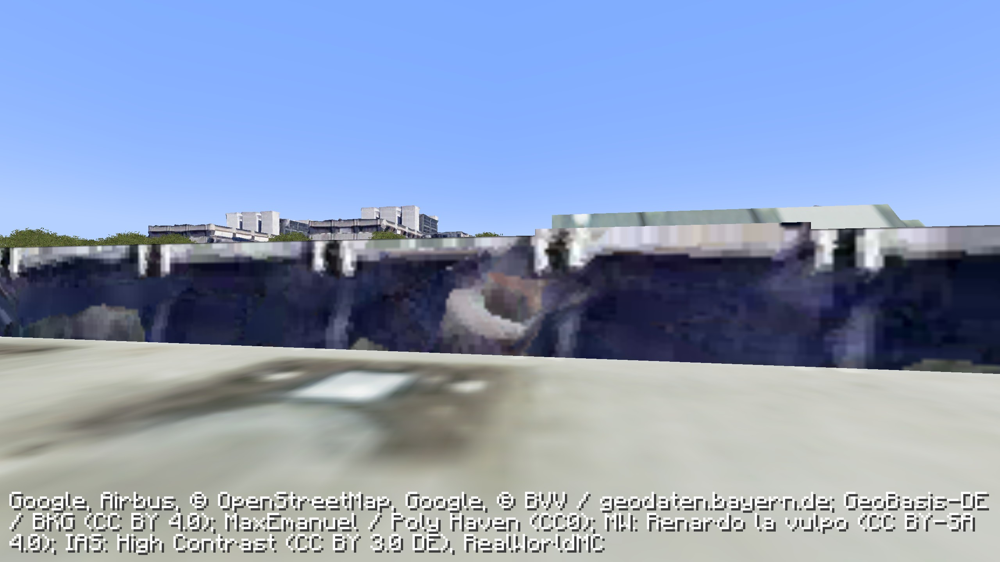

The reconstructed frontage, after correcting gaps between the recessed glazing and columns:

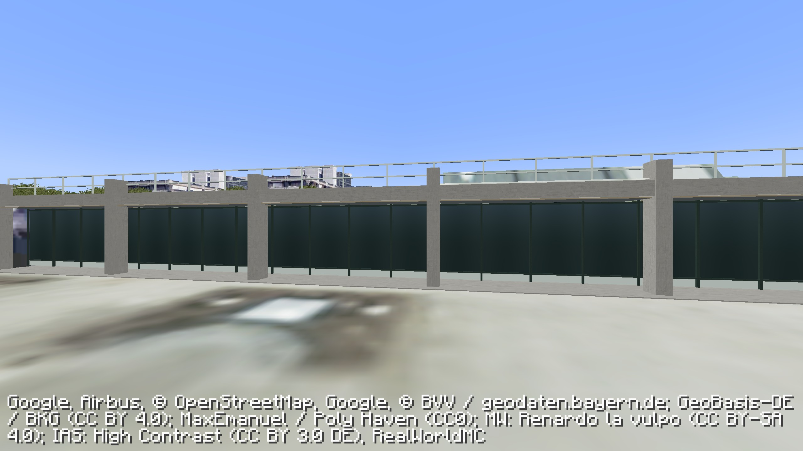

The wider approach remains visibly unfinished:

The photographic pipeline omits a face once its structural replacement owns it, preventing an old flat sheet from covering the new recess. The auxiliary collision surface also omits that old face. A new native assertion verifies air at the former wall position `(5,68,-247)`, solid recessed glazing at `(5,68,-249)` and the overhead canopy at `(5,70,-247)` after collision migration. The exact packaged artifact completed eleven viewpoints and all six native assertions; all 21 service tests pass. All 46 backed-up original save files remain unchanged.

[Exact artifact, native captures, source qualifications and validation](mensa-front-development-validation.json). The overall goal remains open. Remaining work includes the approach’s scan fragments, terrace artwork and pavement, untreated elevations, roof detail and campus-wide fidelity. The installed/public preview is still 0.4.0.

## Terrace retaining walls: `0b4d1eac…`

Fixed native rays identified the large lower-approach fragments as the old source mesh along BVV wall 39 of `DEBY_LOD2_5284422`. This outer terrace wall is 50.10 m long, with only 42.9% photographic coverage of its visible area; keeping its unsupported source mesh preserved the jagged shapes. The existing licensed IAS panorama shows concrete terrace walls and railing beside the building:

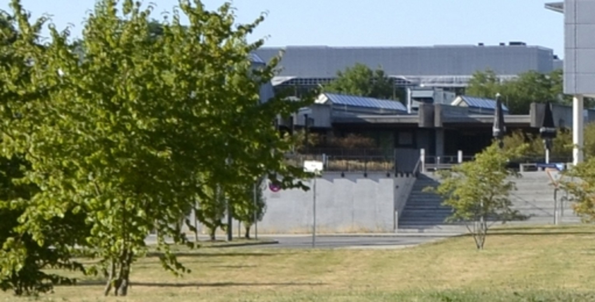

Reference: [High Contrast, CC BY 3.0 DE](https://commons.wikimedia.org/wiki/File:TU_M%C3%BCnchen_Garching_-_Institute_for_Advanced_Study.jpg), cropped from the existing source photograph. The crop is a material/structure reference, not a matching-camera comparison or a survey of every surface detail.

Four lower faces (39, 18, 0 and 27) now use their measured geometry with physically scaled concrete texture. Railing segments are added only where the sampled ground profile shows an exposed drop, keeping the adjoining paved plateau connection open. The source and auxiliary collision faces relinquish ownership to the reconstruction, as for the upper frontage. No interior is added.

At the established approach camera, after full native streaming readiness:

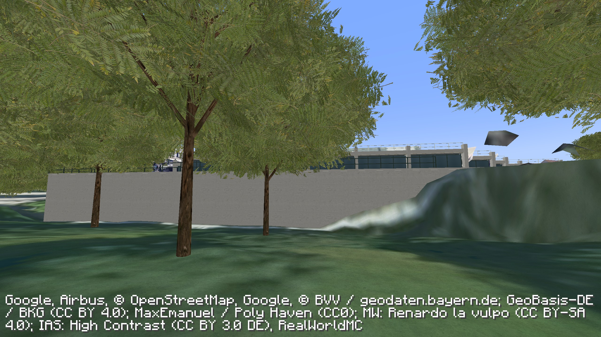

Compare the [previous same-camera capture](../../docs/screenshots/campus-mensa-front-approach.jpg). The large lower fragments are gone. A new native assertion requires the three diagnostic rays at `(0.18,0.55)`, `(0.35,0.58)` and `(0.58,0.56)` to hit the reconstructed wall tile. All eleven viewpoints, seven native assertions, 21 service tests and generated-geometry validation passed. All 46 original backed-up save files remain unchanged. [Exact artifact and evidence](mensa-retaining-development-validation.json).

The overhead fragments remain visible. A public-survey diagnostic links their location to a connected tall canopy extending beyond the currently generated circular crown. Crown ownership currently excludes protected building footprints and clips assigned foliage near the seed; the next correction needs to retain real overhang and fit the crown’s shape. The overall realism goal remains unfinished, and the installed/public preview remains 0.4.0.

## Survey-fitted crowns: `f7a3ff1a…`

The terrace diagnostic showed that the nearby tall canopy extends well beyond its trunk candidate. Crown fitting now assigns connected DOP20 foliage to tree candidates using DOM20 height above surveyed roofs and terrain. It keeps trunk placement separate from crown extent, allows measured overhang over low roofs, and samples foliage positions within that footprint instead of forcing every tree into a circle around its height peak. The 14 m ownership limit is a guard against joining distant vegetation, not a claimed measured crown radius.

The representative trunk remains at approximately `(11.96,63.99,-220.53)`. Its fitted foliage samples extend north to `Z=-232.06`, with a sample centroid at `Z=-224.25`; the previous circular crown ended near `Z=-227.09`. Branches, lower crown boundaries, species and individual leaves remain procedural estimates. DOM measures the upper surface and does not measure a solid foliage volume down to the ground. The lower boundary therefore preserves exposed trunks; unsupported low samples do not become tall-tree foliage. The development scene now contains 739 inferred trees in 36 groups.

At the same native approach camera:

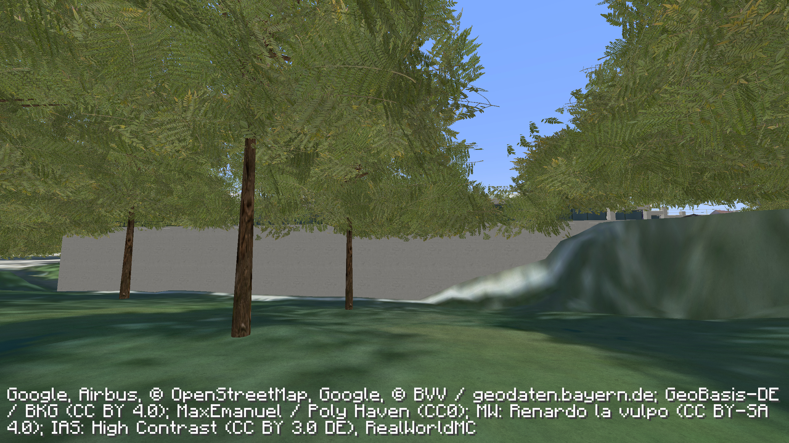

Compare the [previous retaining-wall capture](../../docs/screenshots/campus-mensa-retaining-after.jpg). The two tracked overhead source fragments are removed. New diagnostic rays ignore reconstructed vegetation when testing for old triangles, so merely covering an artifact with a leaf card cannot pass. The three retaining-wall rays still require the measured wall geometry behind any intervening foliage.

The final package passed all eleven captures, eight native checks, 21 service tests and binary geometry validation. The collision fixture migrated 184 proxy blocks while preserving its player block and recorded excavation; all 46 backed-up original save files remain byte-identical. Exact package hashes, all eleven captures and native gameplay results are recorded in [crown-fit-development-validation.json](crown-fit-development-validation.json). This is a canopy correction, not a completed campus realism goal. The low-resolution ground imagery, simplified branches/species, pavement and terrace details, and remaining untreated architecture still need work. The installed/public preview remains 0.4.0.

## Mapped ground materials: `b74ed266…`

The previous ground shader inferred materials from aerial colour and lit every ground normal as though it were horizontal. Blurred shadows and roof/tree colours therefore dominated the terrace bank. The current pass uses closed OpenStreetMap polygons to identify 180 lawns and two paved areas, with twelve water/court exclusions. Their outlines were compared with the BVV orthophoto before use. Mapped material detail fades toward the original imagery at longer viewing distances; unknown surfaces keep their photographic treatment. No terrain vertices or collision rules change.

The [landscape designer’s project description](https://la-bar.de/text-hochschulcampus-garching-tu-muenchen/) supports folded lawns, grey concrete paving and a red asphalt campus band. The polygon outlines and material tags come from [the bundled OSM extract](ground-surfaces.geojson), under [ODbL 1.0](https://opendatacommons.org/licenses/odbl/1-0/). Paver sizes, joints and lawn grain are approximate render materials, not a new survey of those details.

At the existing Galileo ground camera, before:

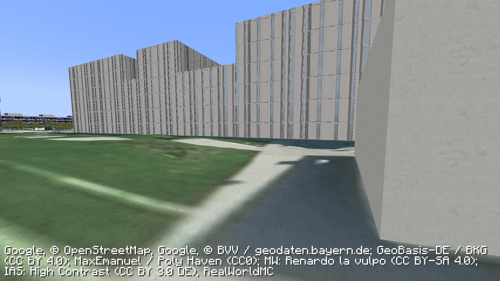

After:

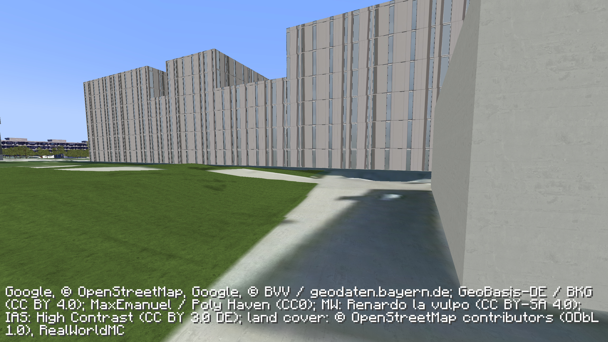

At the established Mensa approach:

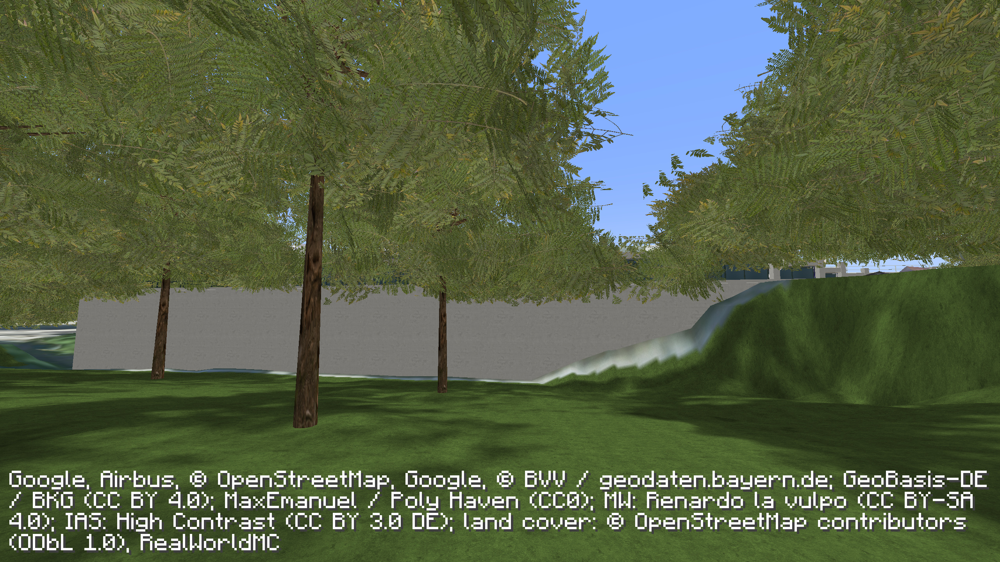

The white strip beside the bank remains outside the mapped lawn. It needs geometry/reference work; this pass does not paint it over. A new camera at `25 65 -125`, yaw/pitch `90 25`, shows the approximate paving material in the mapped MW walkway:

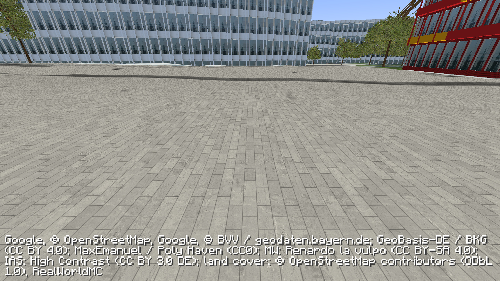

All twelve native captures, eight gameplay/geometry assertions, six material alignment/exclusion controls, 21 service tests and binary geometry validation passed. The original save’s 46 backed-up files remain unchanged. The full renderer fingerprint is now recorded alongside the upstream patch and service bundle hashes, so shader/resource changes are traceable. [Exact artifact and validation](ground-material-development-validation.json).

The overall goal remains open. Fine terrain edges, unmapped path materials, terrace stairs/artwork and the remaining coarse façades are still incomplete. The installed/public preview remains 0.4.0.

## Full DGM1 terrain sampling: `5dba4904…`

The previous mesh used two-metre spacing and selected each containing raster pixel. DGM1 stores samples at pixel centres: the [GDAL geotransform convention](https://gdal.org/en/stable/tutorials/geotransforms_tut.html) places those centres half a pixel inward from the transform origin. The new sampler merges the adjacent elevation files before bilinear interpolation. Every source sample inside the 600 × 600 m campus now becomes an interior mesh vertex; shared 100 m tile boundaries use the same interpolated heights. The two-metre guide remains for source filtering, while rendering and collision voxelization use the one-metre mesh.

Against the source raster, all 360,000 interior positions agree within 0.000022 m and adjoining tile edges match exactly. This measures encoding fidelity, not real-world survey accuracy. The old mesh differed from source samples by more than 25 cm at 3,926 positions outside protected footprints, including 193 in the selected terrace window. Those figures describe the previous interpolation error, not changes to the underlying survey.

At the same Mensa approach camera:

Compare the [previous two-metre capture](../../docs/screenshots/campus-mensa-ground-after.jpg). The diagonal bank edge is cleaner. Steep-face texture stretch, approximate materials and untreated façades remain visible; this is not final campus-quality evidence.

The native bank probe originally assumed a landing at Y=63 and failed at Y=62. Independent triangle interpolation established the actual rendered surface at Y=62.378458, so the probe now checks that measured height with the existing half-block tolerance. Collision migration advances to v5 to realign previous proxy blocks, retaining the existing protections for ordinary blocks and recorded edits. Exact artifact hashes, source checks, native results and original-save verification are recorded in [terrain-development-validation.json](terrain-development-validation.json). The installed/public preview remains 0.4.0 and the overall goal remains open.

## Slope-correct material projection: `ed108ef3…`

The finer Mensa bank still stretched its ground material vertically because every microtexture used a downward X/Z projection. Ground materials now blend three world-space projections according to the surveyed surface normal. Near-vertical mapped lawns also reduce stretched aerial shading, retaining material grain and geometric lighting. Ordinary flat ground retains its top projection; negligible axes and distant detail are skipped to avoid unnecessary texture sampling.

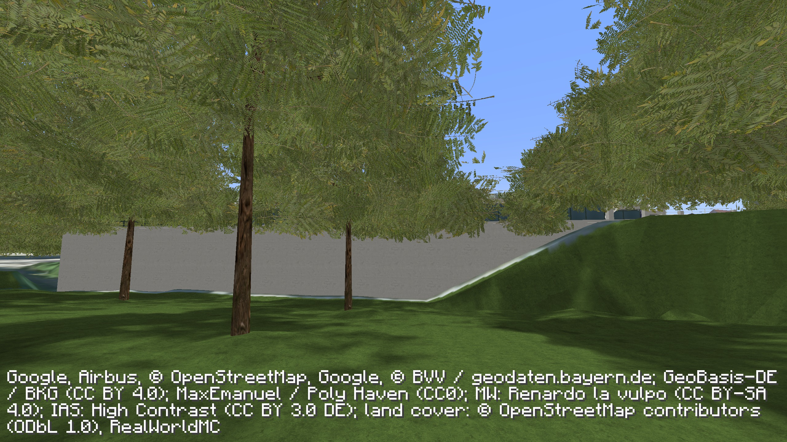

Compare the [previous full-resolution terrain pass](../../docs/screenshots/campus-mensa-terrain-after.jpg). All twelve native route captures and nine gameplay/geometry checks passed, and all 46 backed-up original save files remain unchanged. The mesh and service bundle are identical to the previous terrain-validated build.

Separate runs reported highly variable frame rates, so a development-only resource-pack comparison switched baseline/candidate/baseline in one loaded scene. Its median readings were 41.5, 42 and 35 FPS. This does not demonstrate a slowdown from the candidate, but concurrent system load and advancing daylight limit the comparison; it is not a universal performance guarantee. The first comparison exhausted its timeout after slow streaming, so the harness now gives loading and measurement separate bounded intervals. Future runs also freeze daylight.

[Exact artifact, captures, checks and comparison data](slope-material-development-validation.json). Untreated façades, unmapped paths and terrace detail remain unfinished. The next structural reference is [UYA](RESEARCH.md#uya-exterior-reference-for-the-next-façade-pass). The installed/public preview is still 0.4.0; the overall goal remains open.

## UYA outer façades: `b0ecb5ad…`

The pilot photographic building, BVV `DEBY_LOD2_5284443`, is UYA. Its streamed walls remained too blurred to read at walking height. The [pinned ESO reference](photos/uya-eso-reference.json) shows two narrow roof courts, pale upper walls, 24 upper windows on the long elevation and 11 on the short elevation, with contrasting glazing and ochre lower panels. The roof and footprint match the public survey. [Reference image, attribution and identity evidence](RESEARCH.md#uya-exterior-reference-for-the-next-façade-pass).

Four outer faces now use the surveyed wall polygons with recessed windows, frames, sills, lower glazed bays and infill. The long faces measure 50.87/50.96 m and the short faces 32.00/31.98 m. The short elevations' eaves dip below their outer corners; the common window heads stay below that measured dip. Window dimensions, 0.18 m recesses, lower divisions and materials are estimates. Opposite elevations repeat the observed upper-window pattern by inference. No interior is added.

The existing north-facing camera, before:

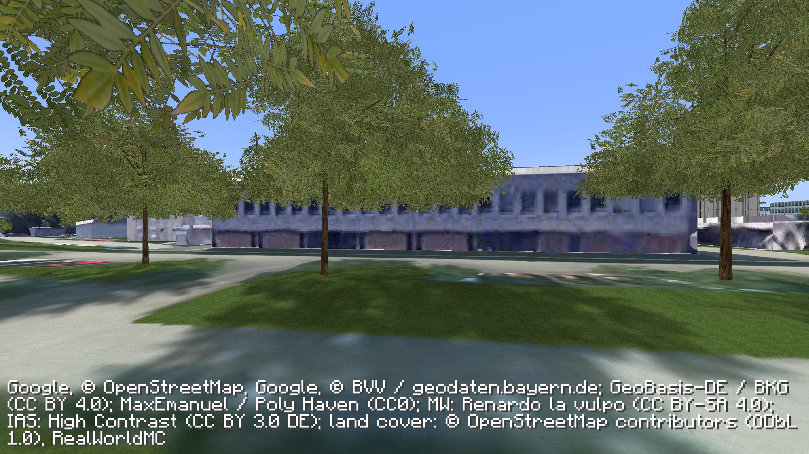

After:

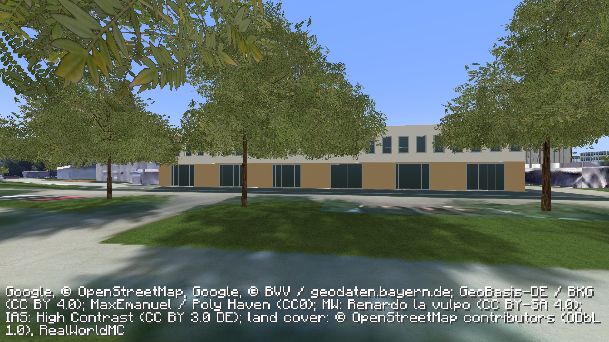

The approach from the west also shows the short elevation:

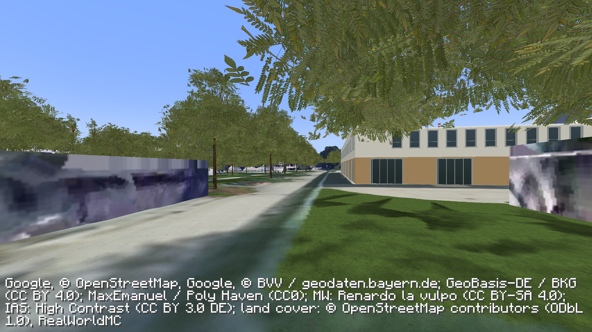

The neighboring photographic walls remain conspicuously coarse. UYE/gatehouse `DEBY_LOD2_31360854` is the right foreground fragment in the west view; diagnostic rays now hit UYA's reconstruction on its own outer walls. The small warehouse `DEBY_LOD2_52738492` also needs treatment. This pass does not establish a finished route.

The roof file is byte-identical to the preceding package, preserving both courtyard openings. Eight inner courtyard faces retain their photographic treatment. Collision migration v6 replaces old proxy geometry while retaining ordinary blocks and recorded edits. Both UYA viewpoints require the new tile to be loaded. All twelve route captures, nine native gameplay/geometry checks, 21 service tests and binary geometry validation passed; the original save's 46 backed-up files remain unchanged. [Exact artifact and validation](uya-development-validation.json).

The installed/public preview remains 0.4.0. The broader realism goal stays open for the remaining coarse structures, paths, terrace detail and courtyard detail.

## UYE visible elevations: `2159712d…`

The UYE footprint and single skylight match the building behind UYA in the ESO aerial and the BVV orthophoto. The architect's exterior reference shows a pale projecting fascia and dark framed glazing. Its 160 m² project area does not establish a complete glazing schedule for the roughly 448 m² survey envelope. Only the east/north faces visible beneath the fascia in the aerial are reconstructed; the west/south photographic faces remain. [Source qualifications](photos/uye-architect-reference.json).

The 29.04 m east face and 15.43 m north face now have a continuous pale fascia, recessed glazing and separate mullions/transoms. Pane counts, horizontal divisions and a 0.50 m recess are estimates. The roof itself is byte-identical to the preceding artifact. There is no interior.

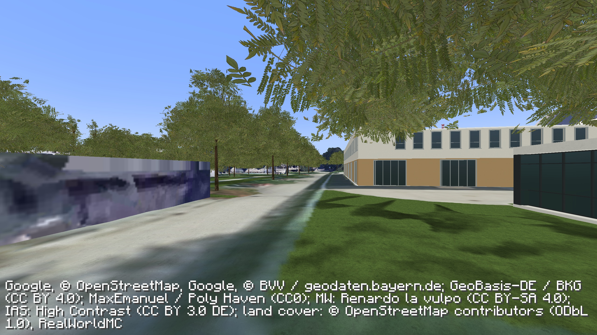

Compare the [previous same-camera view](../../docs/screenshots/campus-uya-west-after.jpg). The right foreground wall is now legible, while the small warehouse on the left remains conspicuously blurred. Twelve native viewpoints and ten gameplay/geometry checks passed. A fixed foreground ray must hit the new UYE tile, preventing a loaded-but-hidden replacement from passing. Collision migration v7 changed 242 proxies during the route while preservation checks passed. All 46 original backed-up world files remain byte-identical. [Exact artifact and native evidence](uye-development-validation.json).

The installed/public preview remains `exterior-0.5.0-dev.1` with UYA; this UYE pass is development work for the next snapshot. Remaining coarse structures, path materials and terrace detail keep the overall quality goal open.

## Warehouse masonry and roof edge: `2e5824e6…`

The low warehouse `DEBY_LOD2_52738492` was the large blurred wall on the left of the UYA/UYE route. The BVV footprint and roof are retained. Its five survey wall sections now use a physically scaled masonry material, pale roof edge and an estimated recessed east opening guided by the [ESO reference](photos/warehouse-eso-reference.json). The west/south opening layout is unknown; those sides are approximate continuous masonry. This is not an as-built reconstruction.

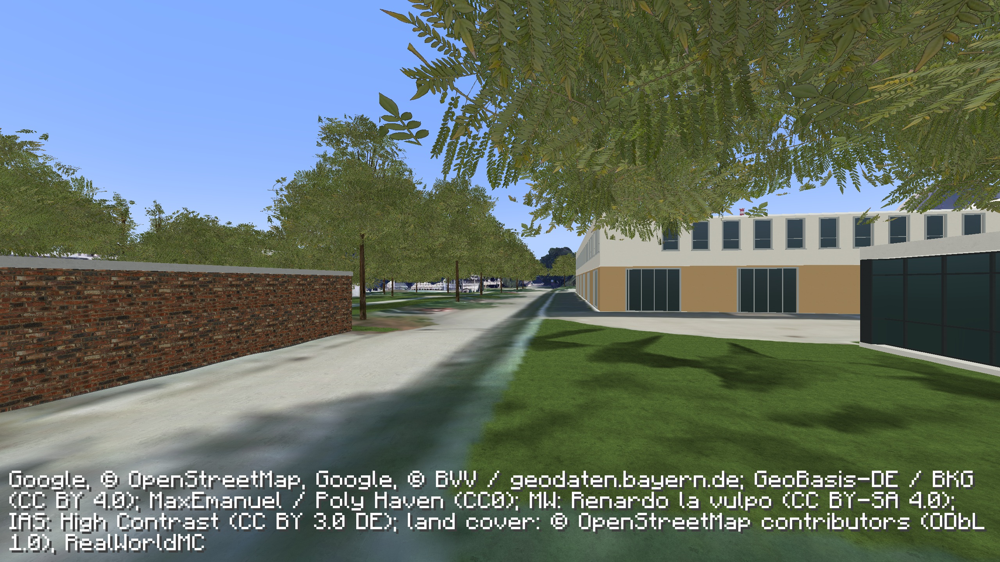

Compare the [previous route capture](../../docs/screenshots/campus-uye-exterior-after.jpg). The material is [Poly Haven Brick Wall 001](https://polyhaven.com/a/brick_wall_001), CC0, by Dimitrios Savva and Rob Tuytel. Colour and repeat scale are adapted to approximate the reference. Its matching normal map uses the surface UV basis and fades with distance; it is not a scan of the actual building.

A thirteenth native viewpoint now checks the east elevation and opening:

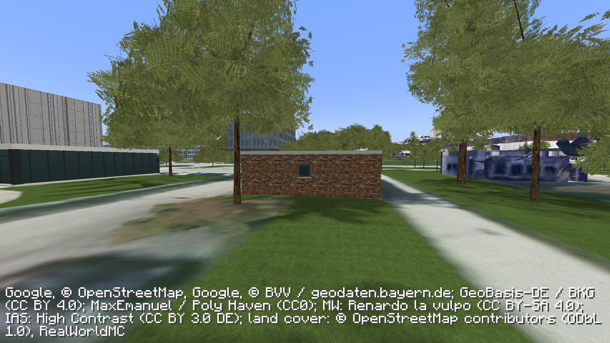

The new view exposes further untreated structures to the north; those remain a quality failure. All thirteen views and eleven native checks passed, including two foreground rays and the east-opening ray hitting the warehouse replacement. Collision migration v8 changed 135 proxies on the route while preservation checks passed. The roof is byte-identical to the preceding artifact, and all 46 original backed-up world files are unchanged. The exporter now omits empty auxiliary wall sections when all faces have been reconstructed. [Exact artifact and validation](warehouse-development-validation.json).

The installed/public preview remains `exterior-0.5.0-dev.1`. This development pass will join the next tested snapshot. Path/road materials, untreated nearby structures and terrace detail keep the goal open.

## Road and path detail: `3aa5bec2…`

Nineteen OSM road/path segments have explicit widths and asphalt/paving tags. Their half-width strips add 7,163.29 m² of material coverage, excluding surveyed building footprints and all existing mapped surface polygons. These are width-derived boundaries, not surveyed curbs. The source lines and derived polygons are included under ODbL; [source data](path-widths.json) and [validation](road-development-validation.json) record provenance and checks.

Before, on the central Boltzmann route:

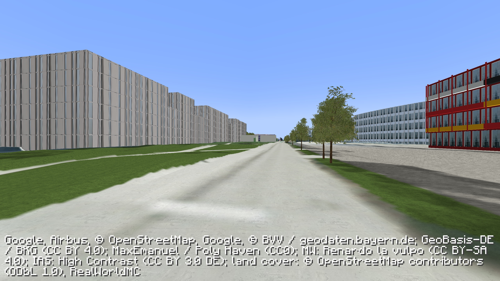

After, from the same camera:

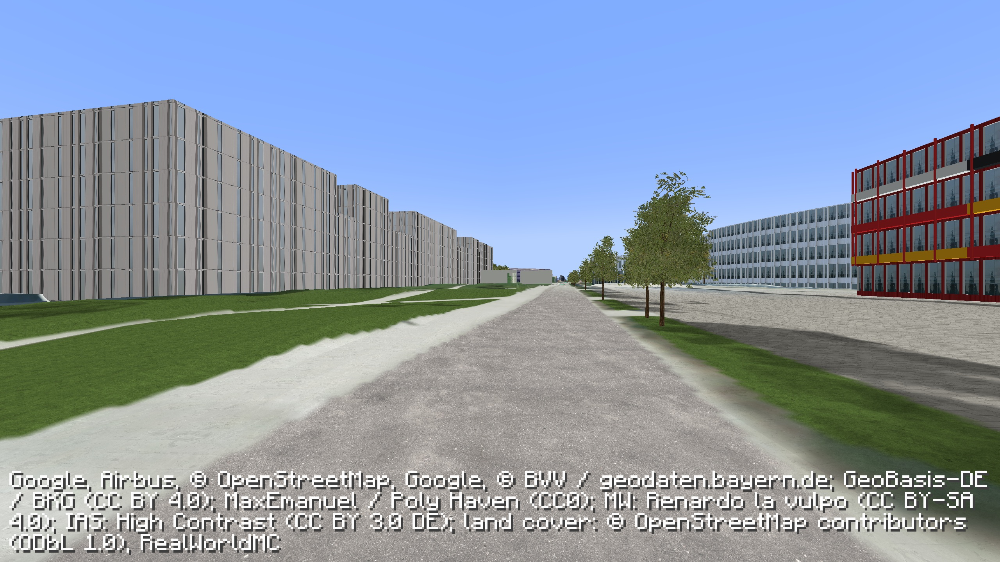

The material uses [Poly Haven Asphalt 04](https://polyhaven.com/a/asphalt_04), photographed by Sergej Majboroda and processed by Jenelle van Heerden, CC0. Its diffuse and OpenGL normal maps repeat at four metres, with broad shading from the aerial image. It is not a scan of this campus road. A fourteenth native view checks it close up:

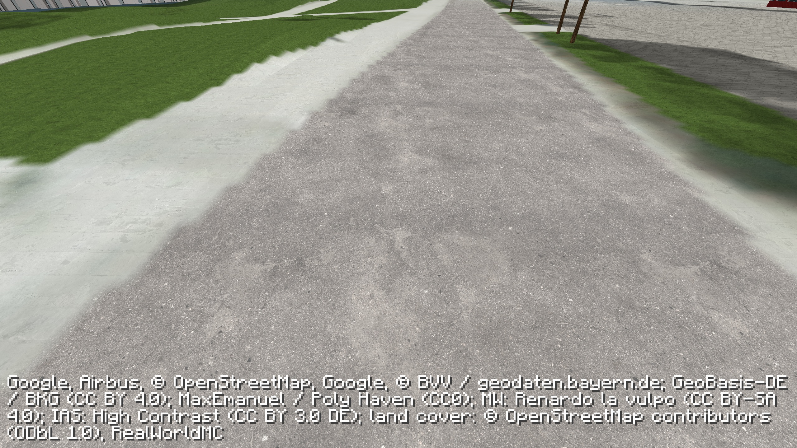

The sharper road makes the untreated pale sidewalks and uneven-looking margins more apparent. Those remain quality failures; this pass does not reconstruct curbs or complete path coverage. The previously exposed northern structures and terrace details also remain unfinished.

All fourteen native captures and eleven gameplay/geometry checks passed. Twelve material-control samples pass, including centres and outside-width points on three paths. Derived strips have less than 0.001 m² numerical overlap with existing mapped areas. All 246 packaged mesh files are byte-identical to the warehouse build; collision v8 remains, with zero proxy changes in this run. All 46 original backed-up save files are unchanged. The installed/public preview remains `exterior-0.5.0-dev.1` until these accumulated changes are published and installed as the next snapshot.

## Playable snapshot `exterior-0.5.0-dev.2`

The road-pass artifact `3aa5bec2…` is the next public development preview. It includes the preceding UYE and warehouse improvements. The separate installed **Minecampus — Exterior Preview 0.5** now uses this exact artifact; its 121 existing save files and local settings were verified unchanged. The old UYA artifact is retained in the instance's `artifact-backups` directory. The original 0.4 installation remains separate. [Play/install/update instructions](PREVIEW-0.5.md).

The update does not establish completion of the overall quality goal. Sidewalks, curbs, untreated northern structures and terrace detail still need work.

## Telefonzentrale west end: `3c0d8f37…`

The smaller western building at Boltzmannstraße 10a is Telefonzentrale (TUM 5130, BVV `DEBY_LOD2_8486669`), connected to Siemensbau (5103) by a passage. Ground photographs beside the four Nobel steles show this building's four-window west end. Its single west survey face now has recessed openings, sills, grey render and a narrow roof joint. Exact opening dimensions, recess and colours are estimates. The roof fascia continues around the outer faces as an inference; other walls retain photography. The connecting passage and survey roof are preserved. [Reference provenance](photos/telefonzentrale-reference.json).

Before, using the installed `dev.2` artifact in a separate QA instance:

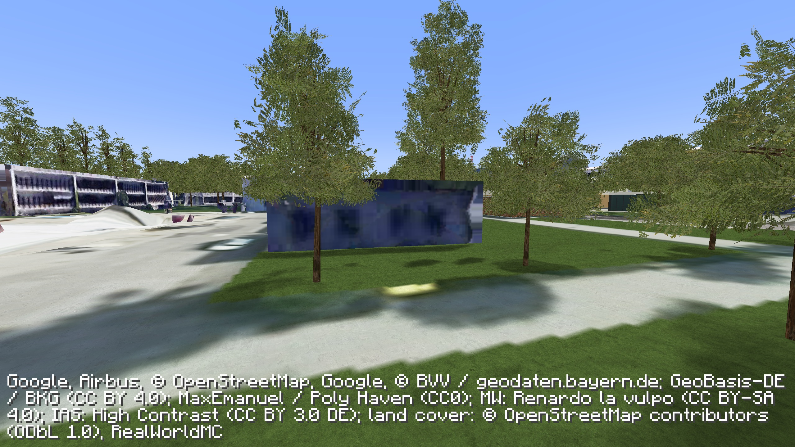

After, from the same camera:

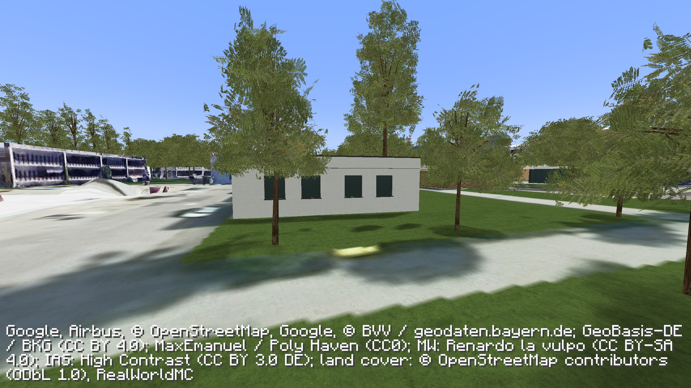

All fifteen native views and twelve gameplay/geometry checks passed, including rays through all four window centres hitting the replacement. Roof-band retirement removes only fully contained triangles, preserving unsupported walls crossing the band. All 22 service tests pass. Collision migration v9 changed 119 proxies across the full route; preservation and journal checks passed. All 46 backed-up original world files remain unchanged. The exact artifact is recorded in [validation](telefonzentrale-development-validation.json).

The neighboring Siemensbau still has coarse photographic walls. The four steles, path margins, curbs and other visible structures remain unfinished. The installed/public preview remains `exterior-0.5.0-dev.2`; this pass is a tested source build for the next snapshot. The overall goal remains active.

## COS exterior and finished-site grading

TUM 5132 / Center for Organoid Systems now uses the complete BVV envelope (`DEBY_LOD2_108698313`), with its stepped roof embedded unchanged. Alexander Pach's [NavigaTUM photograph](https://nav.tum.de/building/cos), CC BY 4.0, supplies the west/south reference and rectified timber material. Recessed openings, floor flashings and the metal rooftop screen replace the obsolete construction-site geometry. Exact dimensions and less-visible elevations are inferred; [source metadata](photos/cos-reference.json) records that distinction.

The DGM still contained construction piles beside the finished building. A local inferred grade follows the surveyed base plus 0.12 m, holds level within four metres, and blends back to the original terrain by eight metres. Neighbouring building footprints plus a one-metre margin are excluded. All 360,000 encoded samples were checked: 357,572 retain DGM heights, while 2,428 use this explicit adjustment; shared tile edges remain identical. Low obsolete source debris and collision are retired over that bounded site. Parking, curbs, paths and furnishings have not been reconstructed to the current photograph.

Before, from the same southwest camera:

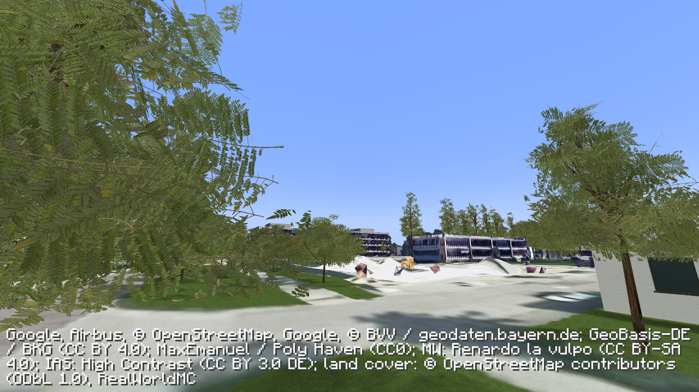

After, in Minecraft Java:

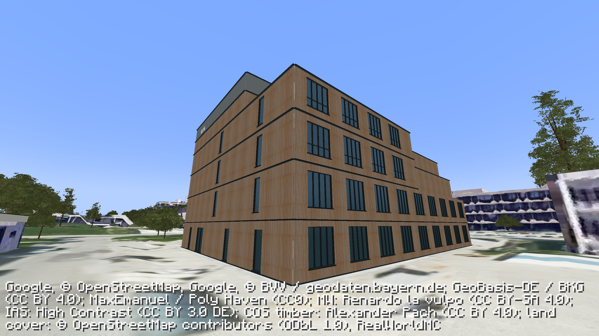

COS persists in aerial mode while unrelated aerial ground retains the original photography:

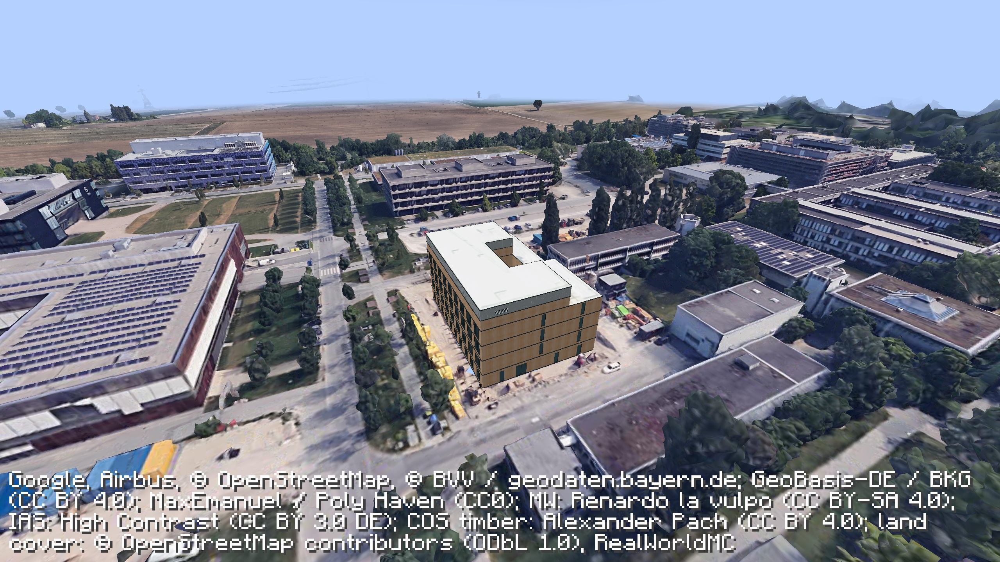

Artifact `d33bf85d9b112279856958605bf901f49d6f3c1cf7aff17fac2603ba6b0cb775` passed eighteen native frames and fifteen checks, including seven COS model/roof rays and gravity landing at the former construction mound. The 25 service checks include manual-only source cleanup and aerial landmark persistence. The original 46 backed-up save files remain byte-identical. [Validation](cos-development-validation.json). Native sampler checks also verify that Minecraft’s initial level-zero clamp is lifted for map tiles and shared materials, allowing their generated mipmaps to be used. The playable snapshot is `exterior-0.5.0-dev.3`, also including the earlier Telefonzentrale pass.

A controlled same-scene comparison isolated the old `GL_TEXTURE_MAX_LOD=0` clamp: generated mipmaps existed but could not be sampled. Lifting only the COS timber texture's clamp to 8 removed the strong wavy pattern. The final build lifts the corresponding clamp for all streamed/map textures and shared campus materials, with ten native sampler checks. Timber also uses a slightly wider sampling footprint; fine board lines are averaged at distance.

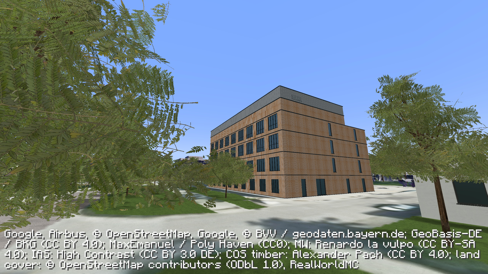

Remaining: visible timber repetition, approximate rear elevations and ground materials, the old construction surroundings in aerial imagery, and coarse neighbouring buildings. These views establish a specific improvement, not completion of the realism goal.

## COS forecourt and site materials

Twelve pinned OSM ways supply the perimeter walk, north/south access drives, connecting paths, two bench lines and bicycle-parking boundary. Ten clipped surface patches add about 954 m² of paving and 310 m² of asphalt. The existing mapped lawns, courts and paths retain their previous pixels; all 36 terrain tiles remain byte-identical to dev.3. [Source and qualifications](cos-site.json).

Two backless wooden benches follow the mapped lines. Their slats, concrete supports and dimensions are inferred. Ten tubular stands fit the mapped parking polygon and its capacity of twenty bicycles; the precise arrangement is estimated. Bench wood reuses Alexander Pach's credited COS photograph. Benches retain collision; thin stand tubes are decorative to avoid metre-wide invisible barriers.

Before and after from the same southwest camera:

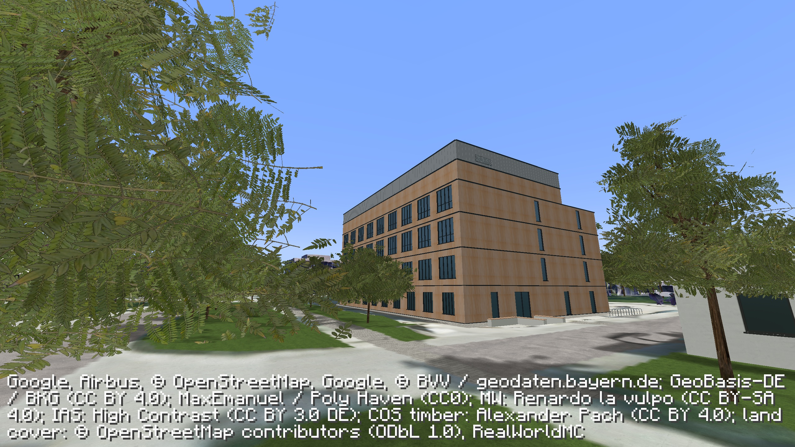

From the forecourt at walking height:

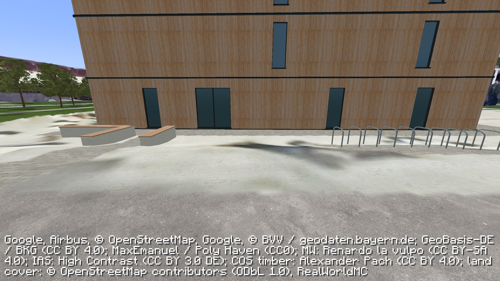

Artifact `8541badba7723d5eb381ddd29366be7deab9a9777d435e4d3318b297e1024325` passed nineteen native captures, seventeen native checks and 26 service tests. New checks verify direct visibility of both benches and a stand, plus gravity landing on a bench proxy at Y=64 above the visible seat at about Y=63.84. All 360,000 terrain samples and 22 material controls pass. [Validation](cos-site-development-validation.json). The separate playable preview is `exterior-0.5.0-dev.4`.

Remaining: unmapped margins still show pale construction imagery; exact curbs, planting beds and furniture designs are unfinished. Aerial surroundings keep the older photographic ground, and site furniture/materials currently appear in walking mode. The adjoining Siemensbau and other coarse facades still need work. This is an incremental improvement, not completion of the quality goal.

## COS planting and smooth forecourt

The [landscape architect's 2021 design context](https://www.wankner-und-fischer.de/projekte/neubau-forschungsgebaeude-cos-garching/) includes paved approaches, planting beds and a north lawn. Current mapped paths and bench positions anchor three explicitly inferred surface patches: about 134 m² of paving, 21 m² of soil and 169 m² of lawn. These are approximate finished-site reconstructions, not an as-built survey. Existing mapped material pixels remain unchanged. The eastern parking area is excluded pending its grass-paver treatment.

The bed follows the inside of the mapped L-shaped bench. Its exposed sides have about 14.35 m of low concrete edging (estimated 14 cm width and 12 cm height). The edging remains render-only to avoid oversized collision barriers. The soil uses Rob Tuytel's [Brown Mud Leaves 01](https://polyhaven.com/a/brown_mud_leaves_01), CC0, at its 1.3 m repeat scale; it is not a scan of the actual bed. Diffuse and normal maps are pinned in [material provenance](material-sources.json).

Before and after from the same forecourt camera:

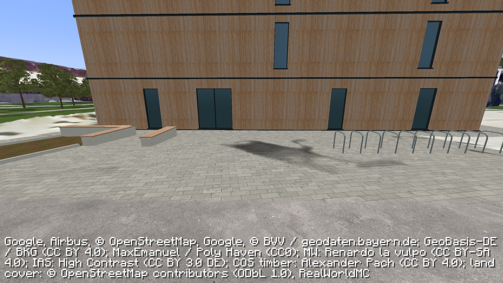

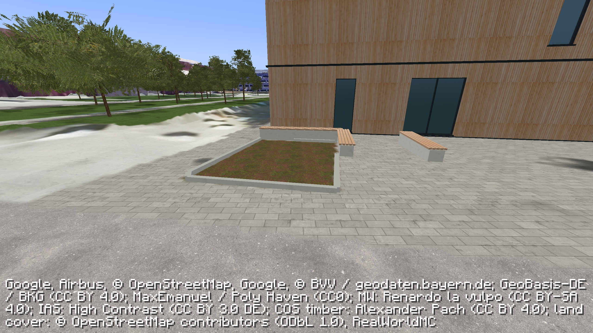

The first close capture exposed an uneven radial grade under the curb. A bounded plane now joins the surveyed facade base plus 0.12 m to the median of six DGM1 driveway samples, rising about 4.8% toward the drive. A 1.5 m blend joins surrounding terrain, with neighbouring building footprints and one-metre margins excluded. Only one of 36 terrain tiles changes; its imagery is unchanged, and every changed vertex lies inside the apron or blend. This is an inferred surface between known anchors, not new elevation survey data.

Artifact `eadcc39e997b167b209ddd91e1ecac2e90a743f0c612736600744c911da2ba09` passed a full 21-view route run, with nineteen native checks, 26 service tests, five terrain tests and 25 material controls. The native bed test checks a ground hit, the packaged soil mask and brown rendered pixels; a second ray reaches the low edging. Gravity lands on the apron at proxy Y=63 where the previous build used Y=64. All 360,000 source samples are checked against DGM plus the documented reconstruction, with identical shared tile edges. Twelve texture samplers have usable mip levels. [Validation](cos-landscape-development-validation.json).

The playable checkpoint is `exterior-0.5.0-dev.5`. Coarse neighbouring facades, pale west-side margins, eastern parking, exact planting/furniture design and old aerial imagery remain unfinished. The overall quality goal remains open.

## GRS north wing

The distorted building east of COS in the north-lawn view is the GRS north office/laboratory wing at Boltzmannstraße 14, BVV `DEBY_LOD2_5284468`. It is distinct from Siemensbau to the south. The [architect's historical project photographs and plans](https://claudia-schreiber-architektur.de/projekte/neubau-buero-und-laborgebaeude-ii-garching) identify the long two-storey wing and its bridge to the octagonal stair tower. The [GRS location page](https://www.grs.de/de/ueber-uns/standorte) and mapped footprint establish the site. [Reference qualifications](photos/grs-reference.json).

Its approximately 47.52 × 12.42 m surveyed envelope now carries recessed glazing, slender frames, pale fascia/spandrels and projecting upper braces. Bay spacing, colours and exact sections are estimated; the reference photographs are monochrome and historical. The observed rhythm continues on less-visible elevations. Reference photographs/drawings are not embedded. The surveyed roof is byte-identical, the east bridge junction remains untouched, and no interiors are added.

Same camera before and after:

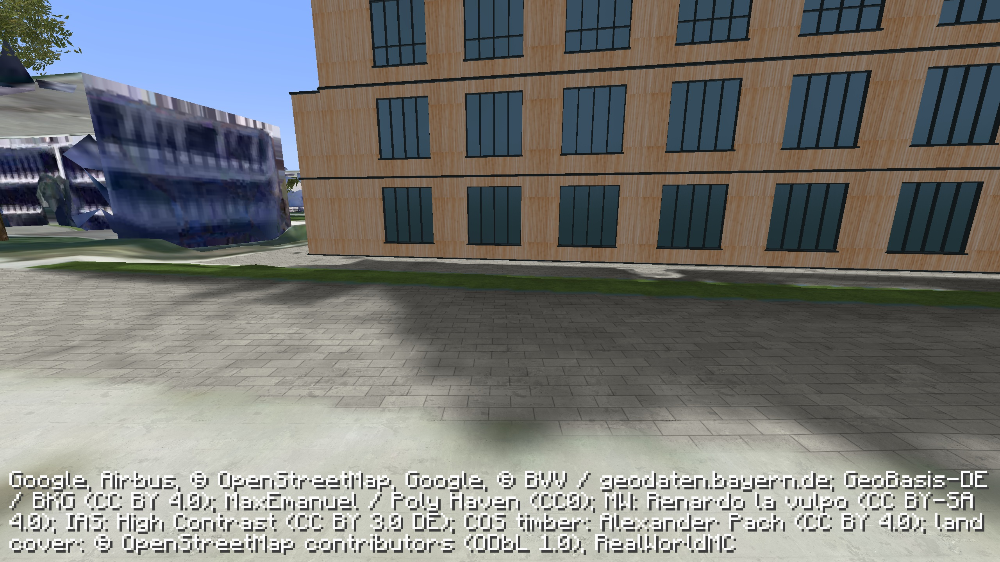

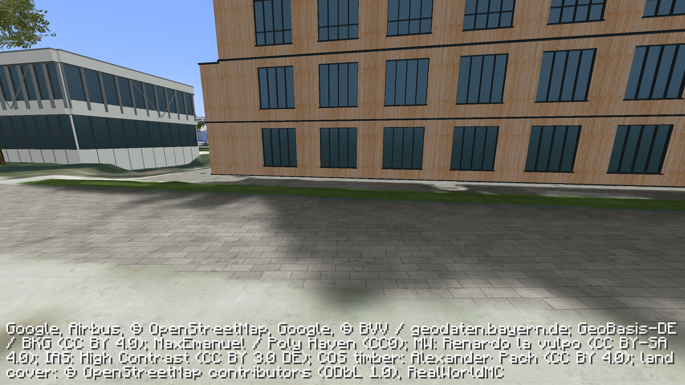

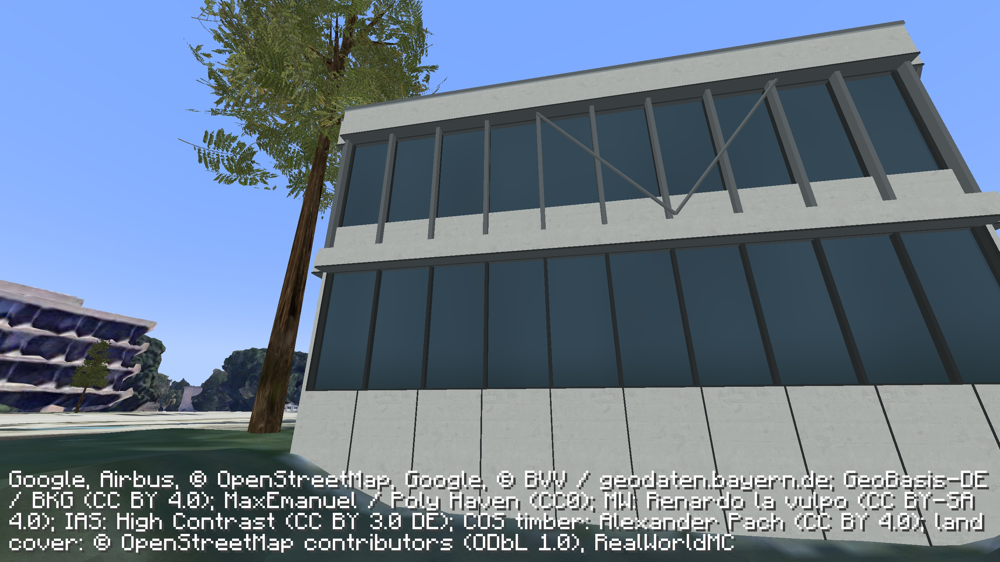

Artifact `284c05a0404e807403d418528b283e58eab0d2b701d1e50b456fde83abe76b24` passed a full 23-view native route and twenty-one checks, including three rays on each new facade view. All 26 service tests pass. All 89 existing render tiles and the other 79 facade plans remain unchanged; collision migration advances to v14 while preserving the native player-edit fixture. Original save files remain byte-identical to their backup. [Validation](grs-development-validation.json).

Development snapshot `exterior-0.5.0-dev.6` remains unfinished: adjacent GRS wings/tower and Siemensbau retain coarse imagery; ground margins and parking need further work, and glazing uses an approximate sky/ground reflection rather than reflecting nearby buildings. The full campus-quality goal remains active.

## GRS stair tower and connecting bridges

Dev.7 reconstructs the octagonal tower (`DEBY_LOD2_5284470`), west bridge (`DEBY_LOD2_104553225`) and short south junction (`DEBY_LOD2_104553232`). Their BVV envelopes and embedded orthophoto roofs are retained. Recessed glass strips, pale diagonal faces, fine frames, top louvres and the courtyard door follow the [architect's historical project photographs](https://claudia-schreiber-architektur.de/projekte/neubau-buero-und-laborgebaeude-ii-garching). Dimensions, colour, door placement and connector glazing remain estimates. No interiors are added. [Source qualifications](photos/grs-connectors-reference.json).

Source removal now respects explicit boundaries around these small structures, including holes and exclusions around neighbouring buildings. This prevents their wall cleanup radius from erasing the adjoining GRS wing. All 90 earlier render tiles, 79 other existing facade plans and previous runtime IDs remain unchanged. Both small links are appended explicitly to the facade inventory. Collision migration advances to v15 and preserves the native player-edit fixtures.

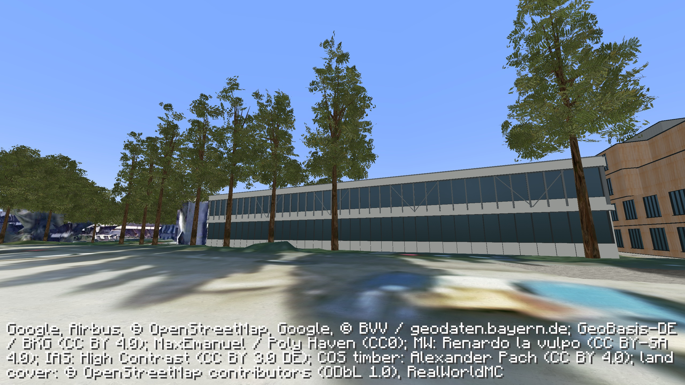

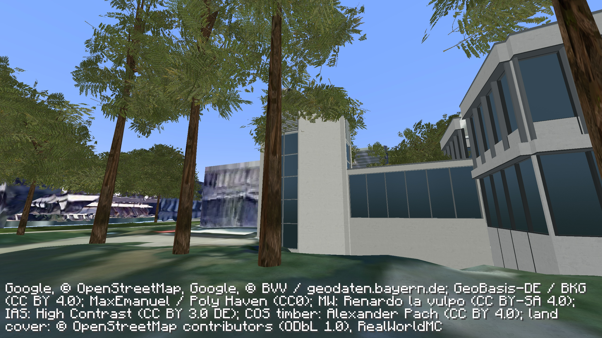

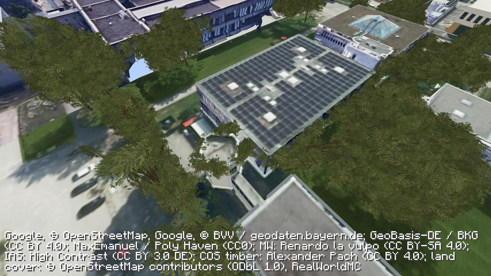

Artifact `c33930d72e6097b082b32e37b3b1da772bbfcb37cc0a2baa7d4e6b7c5ac7ac92` passes 26 native views, 24 native checks and 27 service tests. Ground rays reach the tower and west bridge; aerial structural rays reach all three additions and the retained neighbouring roof behind any foliage. Each new component embeds its survey roof byte-for-byte. Original save files remain unchanged. [Validation](grs-connectors-development-validation.json).

The campus-quality goal remains active: the neighbouring GRS main/south wings and Siemensbau still have coarse photographic surfaces. Ground margins, older aerial imagery, inferred window details and approximate reflections continue to limit realism.

## GRS II exterior and source correction

The apparent overhead fragment in the courtyard is the correctly positioned survey roof of `DEBY_LOD2_5284471`. Native diagnostic rays pass through the absent west wall to that roof's underside, far east/north walls and ground inside the footprint. Dev.8 repairs the closed exterior envelope rather than deleting the valid roof. The approximately 24.05 × 35.71 m BVV outline, chamfered corners and exact orthophoto roof are retained. Recessed glazing, slender frames, pale fascia and upper diagonal braces are reconstructed on the matching GRS II wing. Dimensions, colours and less-visible elevations remain estimates. No interiors are added.

The [complete architect ground plan](https://claudia-schreiber-architektur.de/content/3-projekte/19891009-neubau-buero-und-laborgebaeude-ii-garching/grs2_eg-bearbeitet.svg) places the detailed 1986–1989 project south of the octagonal tower. This corrects the earlier dev.6/dev.7 assumption that the close-up facade photographs directly described the long north wing. That wing is visible in the wide context photograph, but its detailed frame arrangement remains an extrapolation. Unsupported north-wing diagonal braces have been removed; the other four material parts, including its roof, are byte-identical. [Corrected north-wing qualifications](photos/grs-reference.json) and [GRS II references](photos/grs-main-reference.json) distinguish observation from inference.

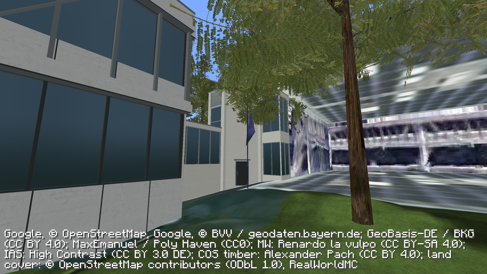

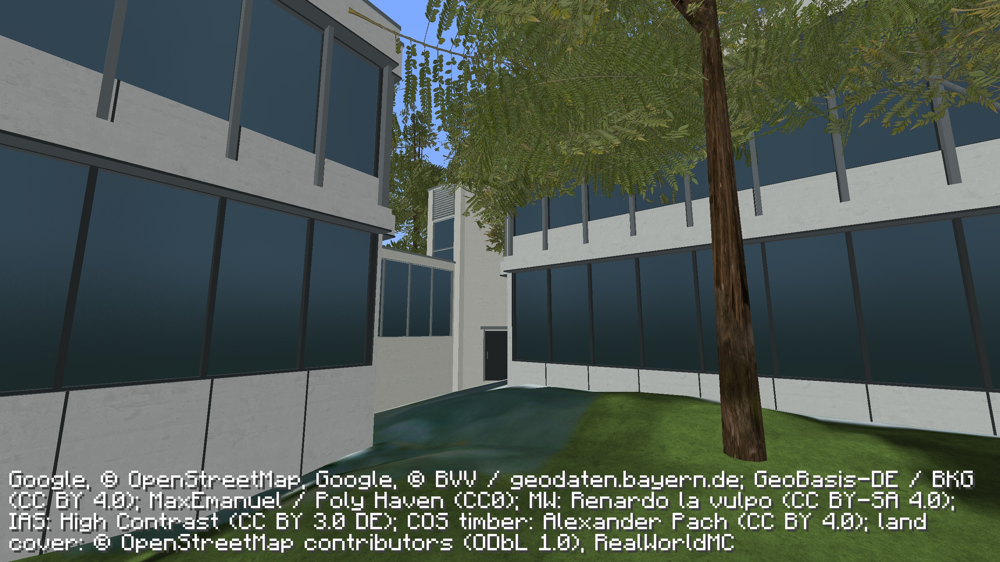

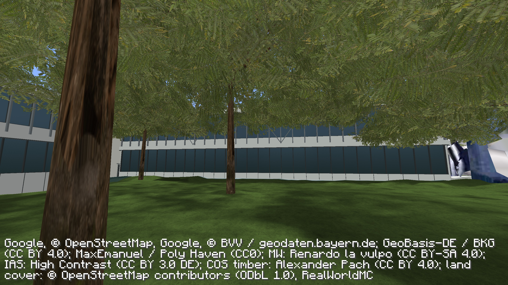

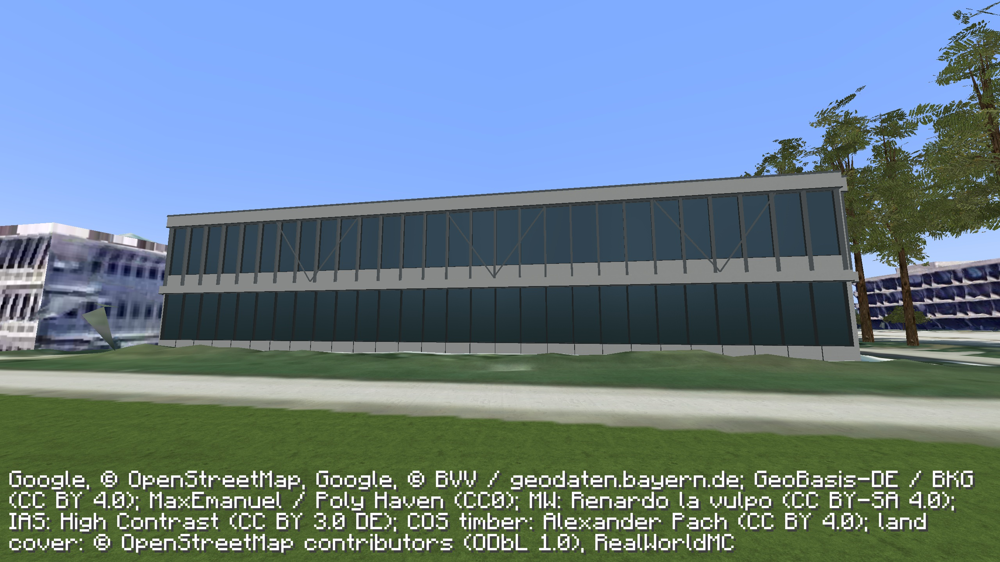

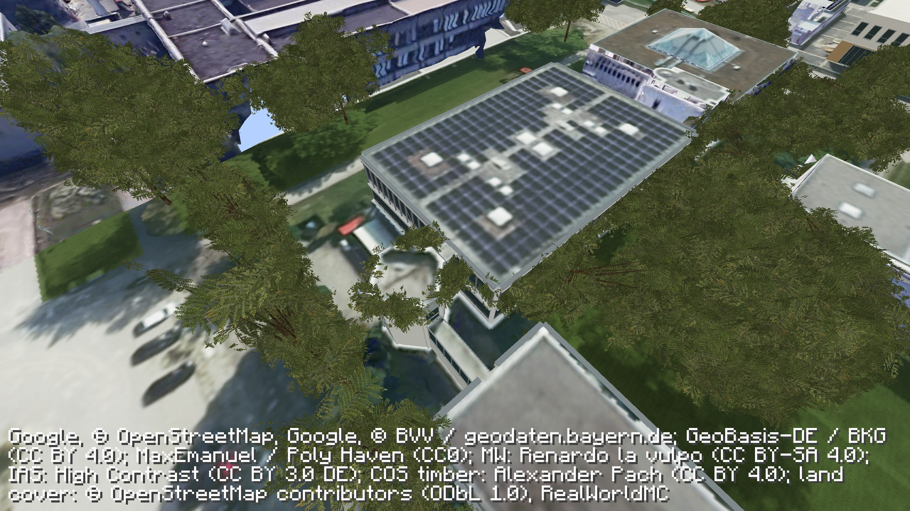

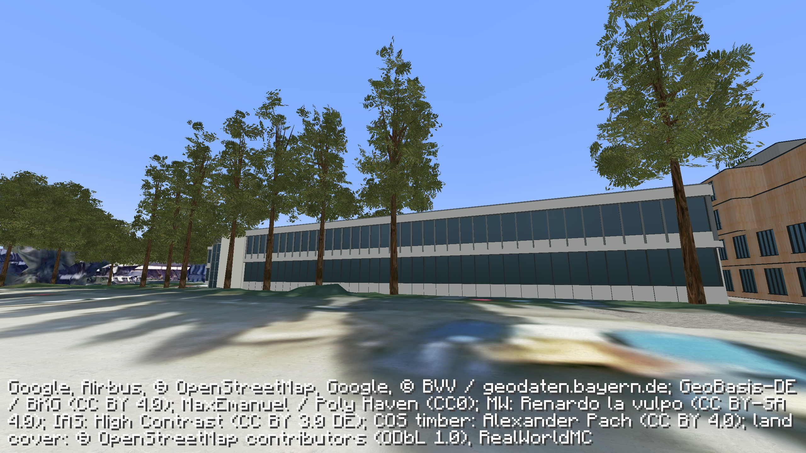

Artifact `1c117a77676f292fe5facb130063a1fc6c5bd013a9d8c19d6d87fe5e4b229beb` passes 28 native views, 26 native checks and 27 service tests. A direct courtyard ray now stops at the repaired west facade; three rays on each west/east view verify exterior coverage behind any foliage. The aerial ray reaches the same surveyed roof in its new complete-envelope tile. All 92 unaffected earlier render tiles and 81 other facade plans are unchanged, and all 82 facade runtime IDs retain their identities. Boundaries protect the separate tower, links and neighbouring buildings. Collision migration advances to v16 and preserves player-edit fixtures. [Validation](grs-main-development-validation.json).

This remains an incremental exterior checkpoint. GRS III, Siemensbau, parking/ground margins, roof detail and reflection quality still need work; the full campus-quality goal is open.

## GRS III square wing and rounded tower

BVV `DEBY_LOD2_5284472` now has a complete exterior informed by the [architect's 1994–1996 photographs, plan and section](https://claudia-schreiber-architektur.de/projekte/neubau-buero-und-laborgebaeude-iii-garching). The approximately 23.95 m square main wing lies south of the attached rounded tower. Its survey geometry matches the plan after rotation. Three glazing bands include the partly exposed lower level; pale floor edges, eight diagonal-set perimeter columns, upper braces and horizontal blinds reproduce the observed architectural character. Bay spacing, blind positions, colours and less-visible elevations are estimates. The tower's unverified rear remains mostly opaque. [Source qualifications](photos/grs-iii-reference.json).

All 30 surveyed wall faces are retained, and all 50 roof triangles and the roof image are embedded byte-for-byte. This preserves the raised central roof; it does not claim a detailed current glazed roof model. There are no interiors or terrain changes.

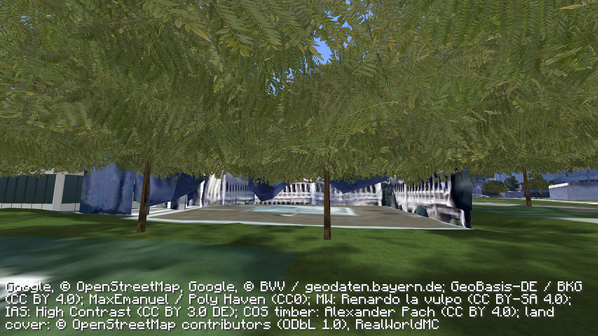

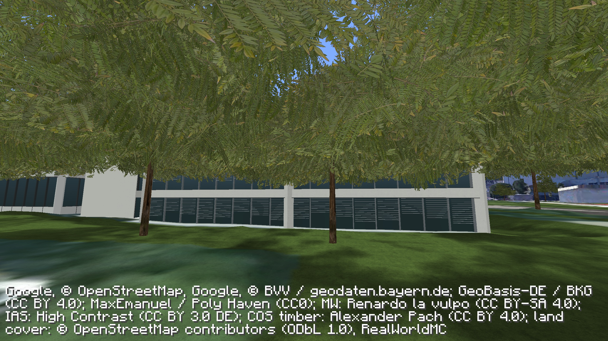

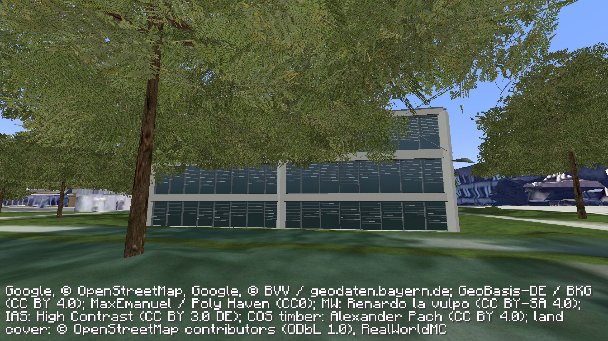

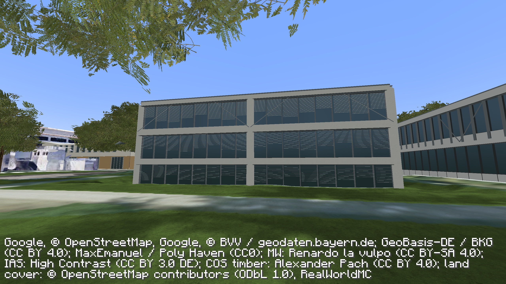

Artifact `436b688c24f1ead360d40153f4785cde34e2e208eef2ec0e21e1f3ec3c2d190a` passes 33 native captures, 31 native checks and 27 service tests. New rays check three points on each west/south/east facade, two tower/link targets and two roof targets, including behind foliage. All 94 previous render tiles, 81 other facade plans and 82 runtime identities are unchanged. Cleanup boundaries exclude neighbouring footprints. Collision migration v17 preserves player-edit fixtures. [Validation](grs-iii-development-validation.json).

The full campus goal remains open. The tree-covered west view is a useful same-camera comparison but not sufficient by itself to judge the facade; the south/east views provide additional evidence. Courtyard surfaces, parking, Siemensbau, detailed roofs and broader material realism still need work.

The tower view still contains a stray scan fragment behind its right edge. A separate native inspection locates it on/near the small surveyed connector `DEBY_LOD2_5284469` (4.28 m²), which is below the photographic-candidate size threshold. Its protected neighbouring footprint explains why the GRS III replacement leaves it intact. This is a concrete next repair, documented in the validation record; the broader quality goal remains open.

## GRS II/III connector and courtyard approach

The separate 4.28 m² connector `DEBY_LOD2_5284469` was below the facade-candidate threshold, leaving conspicuous scan fragments behind the rounded tower. It is now appended explicitly as plan `1_000_050_082`, with all four surveyed walls, two inferred glazing bands and the exact two-triangle survey/orthophoto roof. Existing plan IDs remain unchanged. Its cleanup margin excludes neighbouring buildings and extends three metres above its roof to cover the diagnosed scan spike. The main GRS II/III envelopes remain intact.

The [architect's courtyard photograph and plan](https://claudia-schreiber-architektur.de/projekte/neubau-buero-und-laborgebaeude-iii-garching) support a narrow paved approach to the tower door. A 1.8 m estimated strip adds 41.05 m² of paving between the door and east walk. Low 6 cm edging follows the DGM; its dimensions are inferred and it creates no metre-wide collision barrier. Building footprints and existing mapped materials retain precedence. The exact terrain mesh is unchanged. [Source qualifications](photos/grs-courtyard-reference.json).

Artifact `c94315901c1a6b29f3390a4833dbebf292e5e36a759f6200299a2e8dfe96e3fc` passes 35 native captures, 33 native checks, 27 service tests and 25 ground-material controls. The new checks verify the former upper fragment is absent, the lower ray reaches the reconstructed connector, a neighbouring GRS II ray remains intact, two ground rays reach the paving mask and the low edging is visible. The stage-32 aerial test is also corrected: its first ray now reaches the raised main GRS III roof; previously both rays reached the tower. All 95 earlier render tiles, 82 earlier facade plans and the terrain guides are unchanged. Only 1,527 previously unassigned material pixels change, within the path and outside buildings. Collision migration advances to v18. [Validation](grs-courtyard-development-validation.json).

This is still a development checkpoint. Courtyard planting, nearby coarse facades, older ground imagery and the renderer's simplified reflections/lighting remain unfinished.
