# Exterior Preview 0.5

## Local reviewed upgrade — candidate 94

The development machine has the reviewed Galileo east frontage repair installed, SHA-256 `60fb1985223086f1b790d4b78a013f54fd60bf10e6582e80c706910163eae144`. It smooths the terrain beside the facade and aligns ramp retaining-wall tops to the inferred finished grade. Both ramp floors now use fractional collision: all 13 native standing checks passed within 0.048 m of the rendered surface. Fourteen camera views and all 41 resulting images were reviewed. The existing preview saves and private settings were preserved during installation. [Repair evidence](galileo-east-grade-development-validation.json).

The grade combines surveyed building bases, nearby terrain controls and the landscape architect's description of a connected east frontage. It is inferred, not an as-built survey. Ground colours remain pale and blurry, nearby untreated buildings remain coarse, and facade details remain approximate. The broader realism goal remains open. The preceding candidate 93 campus-wide review is retained [separately](preview-upgrade-93-development-validation.json); this latest review concentrates on the changed frontage and ramps.

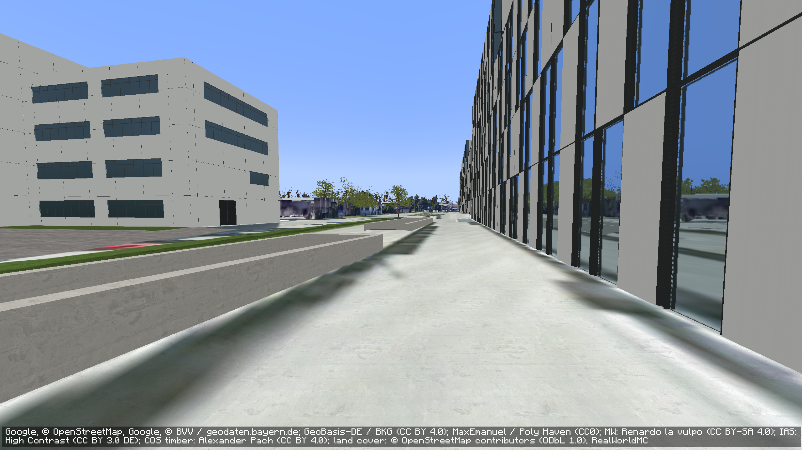

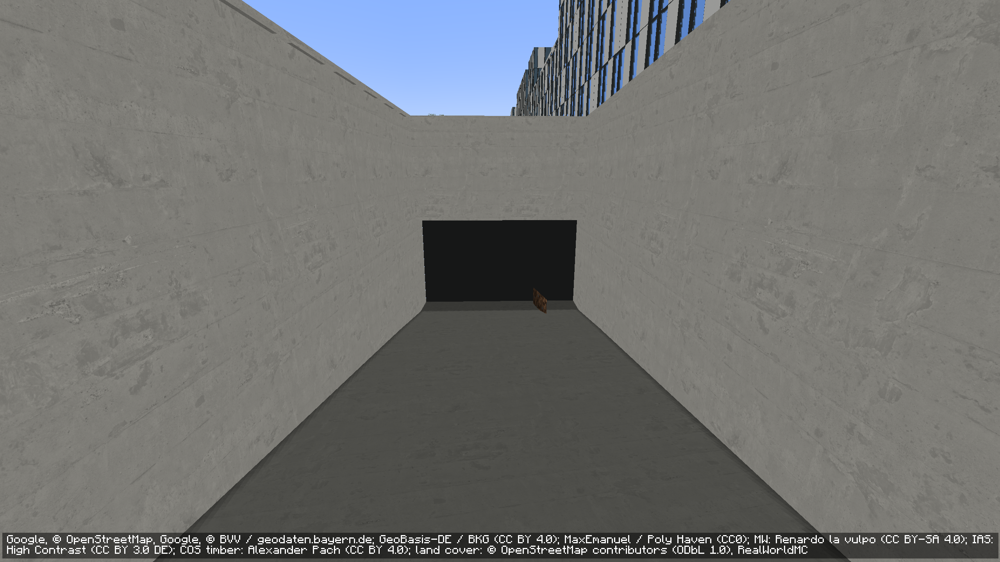

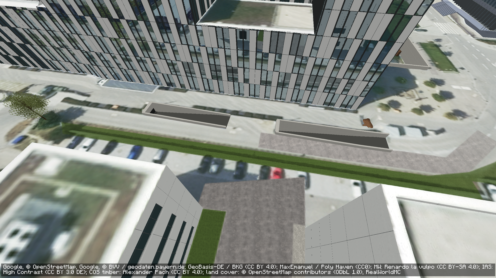

This local artifact has not been published as a new GitHub binary release. When it is present locally, update the existing preview with `python3 scripts/install-exterior-preview.py --update --reviewed-upgrade`. The installer checks its separate review and exact hash, backs up the old mod, and preserves saves and local settings. Without `--reviewed-upgrade`, it continues to accept the published dev.22 artifact described below.

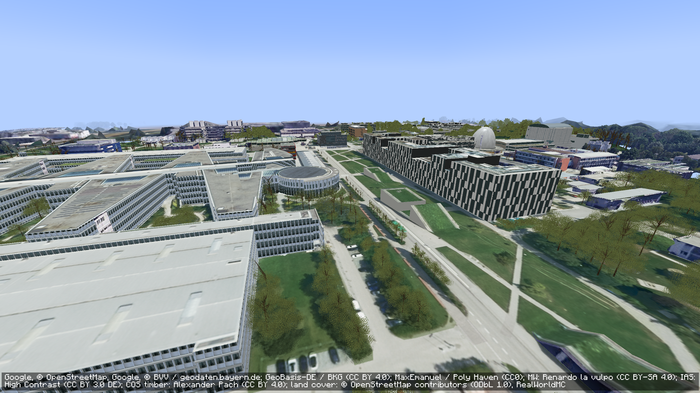

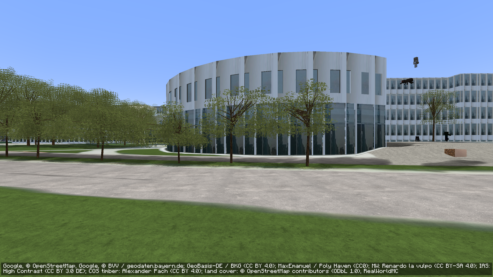

## Published development preview — dev.22

This playable development snapshot adds the IAS exterior, survey-aligned photographic walls, the former Mensa terrace frontage and retaining walls, UYA's outer façades, UYE's east/north glazing, the masonry warehouse exterior, width-mapped road materials, the Telefonzentrale west end, the COS exterior, approximate finished-site grading, mapped site paving, benches, bicycle stands, an inferred planting bed, a smooth forecourt grade and the GRS north wing, stair tower, connecting bridges, repaired GRS II exterior and GRS III square wing/rounded tower, the small GRS II/III connector and a paved courtyard approach, survey-fitted tree crowns, mapped ground materials and full DGM1 terrain sampling. Four main asphalt promenade corridors, eight crossing/entrance paths and smoother ground-material boundaries reduce blurry path margins. Galileo’s northern sunken courtyard now has retaining walls, a lower paved floor, five stair flights, handrails and lower exterior glazing, replacing the stretched terrain bank. The two Galileo facades now have separate pale metal panels, recessed glazing, fine joints and narrow ventilation fins in place of the repeated photographic strip. It also adds local mesh shadows that follow the sun, react to terrain damage, and turn off at night. Nearby Galileo glazing now reflects loaded campus meshes as you move, with day/night lighting and damage-aware panes. Three spurious pits in Galileo’s western paved frontage are now replaced by a bounded, source-informed grade. The two eastern access ramps now have source-profile slopes, retaining walls, coping and shallow exterior entrance recesses. The neighbouring MLZ UYW/UYL buildings now have surveyed envelopes with distinct recessed window groups, concrete panel joints, closed service doors and preserved stepped roofs. The surveyed campus now stays visible at every altitude, including an airborne start and views from outside the survey boundary. Siemensbau 5103 now has a surveyed envelope, recessed window groups, sills, closed exterior doors and a preserved roof. RCM-Technikum 5104 now has continuous surveyed hall walls, a preserved stepped roof and individually estimated recessed openings in place of detached photographic sheets. It runs inside Minecraft Java 1.21.1 with the existing Minecampus add-on and Fabric setup.

The campus is still unfinished: several neighboring walls remain blurry, paths have inconsistent detail, and reconstructed window divisions/materials are approximate. Interiors are outside this pass. The public default installer remains on 0.4.0.

## Play the installed copy

On the development machine, restart the official Minecraft Launcher, open **Installations**, select **Minecampus — Exterior Preview 0.5**, and click **Play**. Open **Minecampus Garching** from Singleplayer. The copied world preserves inventory and edits as they stood when installed. Further progress belongs to this preview copy; the original **Minecampus — TUM Garching** installation remains separate.

Allow the map to finish streaming before judging geometry. The photographic façade pass can take several minutes on first entry. Existing local map credentials are reused; no new key is needed.

## Install the same snapshot alongside an existing setup

1. Quit Minecraft and its launcher.
2. Download `RealWorldMC-Minecampus-Exterior-0.5.0-dev-mc1.21.1.jar` from the [0.5 development preview release](https://github.com/DocMorphic/minecampus/releases/tag/exterior-0.5.0-dev.22) into this repository's `dist-minecraft/` directory.
3. On macOS/Linux, run `python3 scripts/install-exterior-preview.py` from the repository root. This requires the normal Minecampus installation and its map setup to exist already. It verifies the artifact hash, checks world locks, copies saves into a separate instance, verifies every copied save file, and adds the preview launcher profile. For an existing preview, use `python3 scripts/install-exterior-preview.py --update` instead. This verifies the recorded mod, refuses an open world, backs up the old mod, and replaces only that mod while verifying that saves and local settings stay unchanged.
4. Restart the launcher and follow the play instructions above.

The installer uses the current user's local map configuration, stored privately in the new instance. Credentials, saves, Minecraft assets and streamed provider imagery are absent from the public download.

## Evidence

The released JAR is the exact native-tested artifact: SHA-256 `6b5166dae7f7935c45fae06ee5f4625816c9eab8217144b23045d17f6af8ba86`. [Detailed evidence](rcm-technikum-development-validation.json) records the full 57-view route and all 40 existing checks, 50 retained MLZ opening rays, ten MLZ wall collision controls, all 17 courtyard/frontage/ramp gravity probes, and both 57-frame GPU shadow/reflection routes. A separate 14-view inspection checks 15 RCM wall/opening surfaces, 33 retained Siemensbau openings and three native wall colliders. Every image was reviewed. All 11 shaders and 17 map-service code files are unchanged from dev.21; the detailed time-of-day/reload tests and service tests remain retained evidence rather than fresh reruns.

RCM-Technikum replaces detached and folded wall sheets with its five-face surveyed envelope. All four roof triangles and the stepped roof image remain exact. Its few visible dark features guide estimated windows/vents; opening dimensions, classifications, frames and recesses are approximate. Obscured lower details remain unresolved. [Source specification](rcm-technikum-5104.json) and [research](photos/rcm-technikum-reference.json) record these limits. No interior is added.

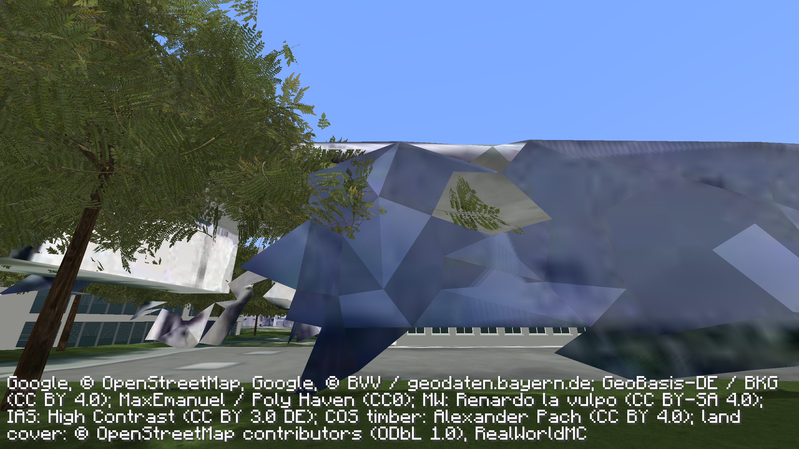

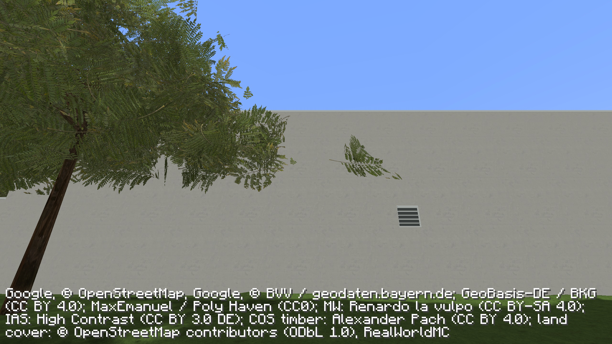

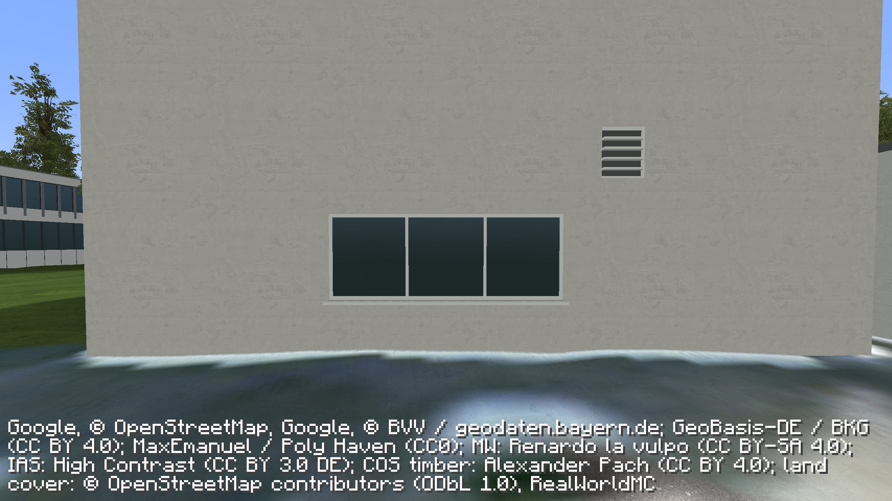

All 104 prior render meshes and 83 survey roofs remain unchanged. Source cleanup excludes neighbouring footprints with a 0.5 m guard, including the nearby Siemensbau. Trees obscure parts of the eastern approaches; close and elevated study views supplement them. Photographic ground colours, roof detail and untreated neighbouring walls remain imperfect. This is another development checkpoint, not completion of the campus-quality goal.

The preceding Siemensbau checkpoint replaced six folded survey faces with recessed openings, sills and closed exterior doors. Its north opening groups follow available local observations; obscured segments and southern openings remain explicitly estimated. [Siemensbau assumptions](siemensbau-5103.json).

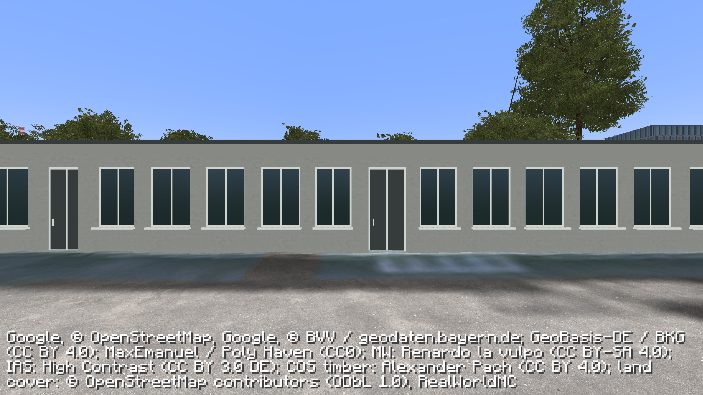

The retained shader smoothly reduces shadow reception within approximately three degrees of parallel sunlight, removing prior triangular noise and periodic wall stripes. It is an approximate stability treatment. [Shadow study](siemensbau-shadow-review.json) records rejected alternatives and the dev.21 TNT, morning/evening/night and resource-reload checks. Thin edge aliasing can remain.

The preceding altitude checkpoint remains in place. Before dev.20, the game hid 91 of 103 reconstructed render tiles when starting above the campus or ascending through its height threshold. Intermediate views could differ depending on whether the player approached from above or below. The map service now keeps the complete surveyed scene at every height, including views from outside the survey coverage. Its existing bounded source cleanup remains in place. That native sequence retained all 103 then-existing render tiles across airborne startup, ascent, descent, an outside-camera view and return.

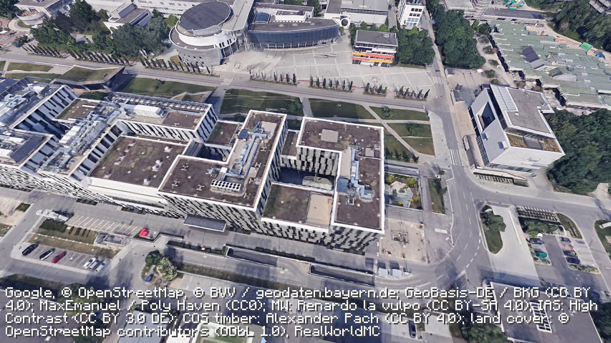

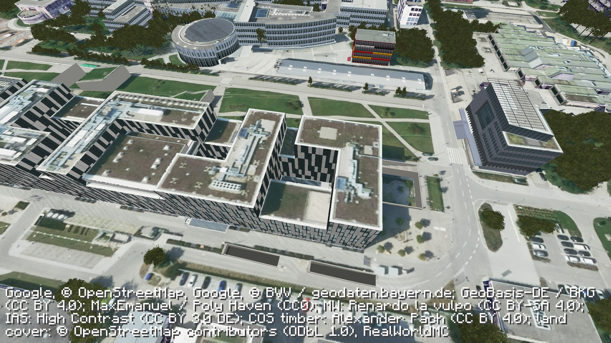

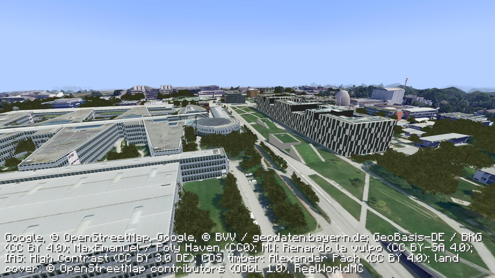

In that preceding altitude checkpoint, only the packaged map service changed: all 269 mesh/roof/collision files, the manifest, renderer classes, shaders and textures are byte-identical to dev.19. The flight check samples settled spectator positions through the relevant heights; it is not a continuous-flight recording or a controlled performance benchmark. Reconstruction still has approximate architecture, missing roof equipment, baked image colours and coarse untreated neighbours.

The preceding MLZ checkpoint reconstructed the two MLZ workshop/laboratory buildings beside Galileo as three surveyed bodies. Official photographs and FRM II/TUM footage guide the individual opening groups, recessed glazing and large concrete panels. The southern upper-window groups also follow the photographic baseline. Dimensions, lower obscured openings and small architectural details remain estimates. The survey roof triangles and all 100 previous render meshes are byte-identical; only verified shared-wall overlaps are removed. A bounded cleanup removes the tracked floating wall and roof fragments while protecting other building footprints.

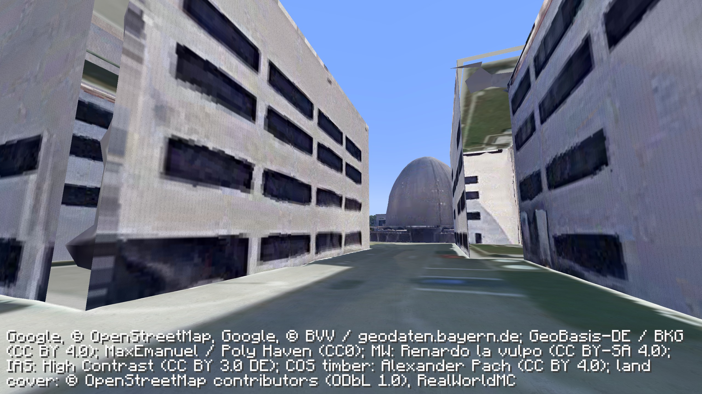

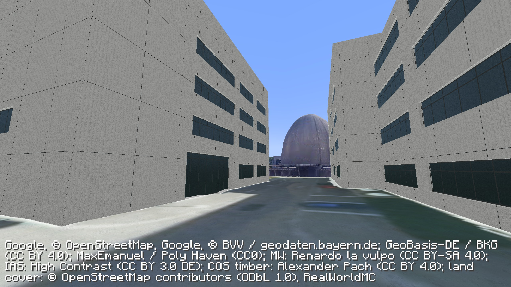

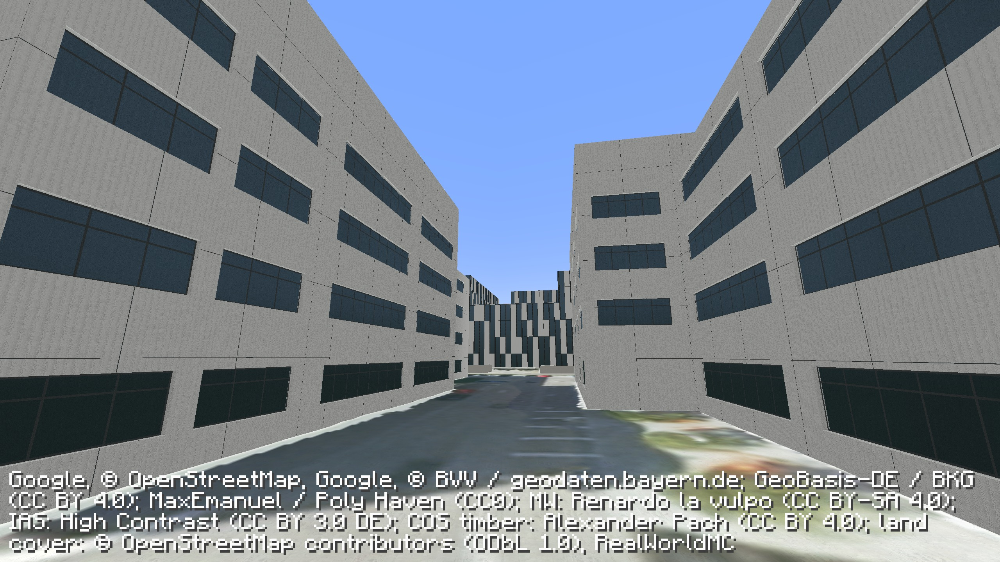

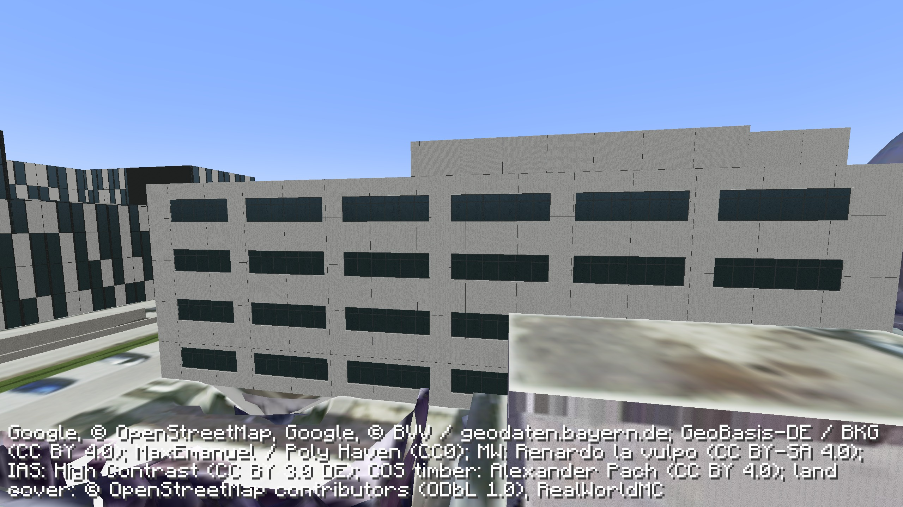

The southern comparison is elevated above adjacent workshops; the lane and ramp views provide ground-level verification. Roof equipment, surrounding workshops, landscaping and baked ground colours remain unfinished. This checkpoint does not complete the broader realism goal. [Source assumptions](mlz-exteriors.json) and [research references](photos/galileo-east-neighbours-reference.json) distinguish observed features from estimates.

The preceding ramp checkpoint replaced the stretched banks around Galileo’s two eastern ramps with approximately 349.17 m² of bounded cuts, sloped floors, retaining walls and entrance recesses. The runs and height profiles follow mapped driveways and pinned source elevations. The 3.6 m width, wall/coping dimensions and shallow portal geometry are inferred from orthophotos and cross-sections; this is not an as-built survey, and no garage interior is included. That ramp update changed two ground tiles and left its other 97 existing meshes byte-identical; later checkpoints preserve all of those meshes.

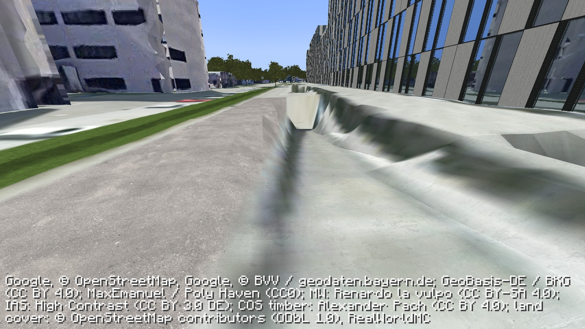

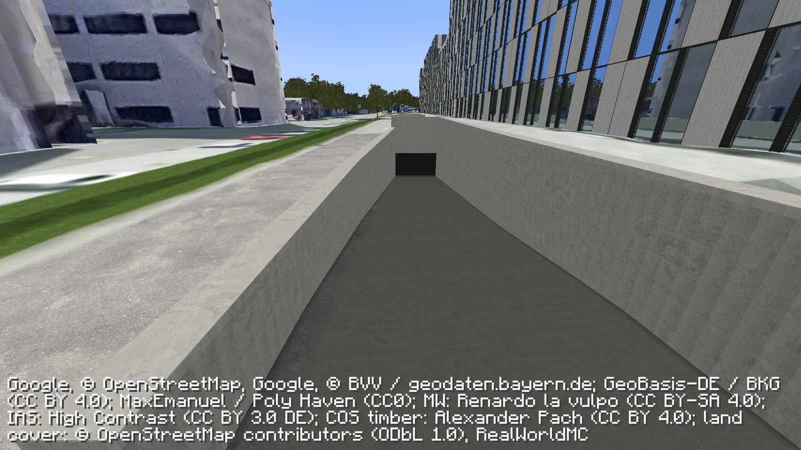

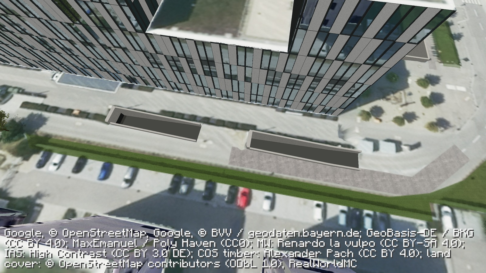

Six native player drops support both slopes within their gradient-derived one-metre voxel bounds. Maximum measured standing offset is about 0.520 m; collision remains an approximation of the visual slope. The northern courtyard and western frontage repair pass their existing gravity checks.

The earlier MLZ checkpoint added material routing without changing its shadow/reflection shaders; the current Siemensbau checkpoint adds its material route and the qualified shadow attenuation described above. Additional moving-camera, night, resource-reload and disconnect/reopen evidence remains [recorded against dev.16](reflection-development-validation.json); the current route freshly verifies lighting, reflections, TNT and collision preservation. Baked vehicle/shadow colours remain visible in paving, and neighbouring workshops still have coarse photographic surfaces.

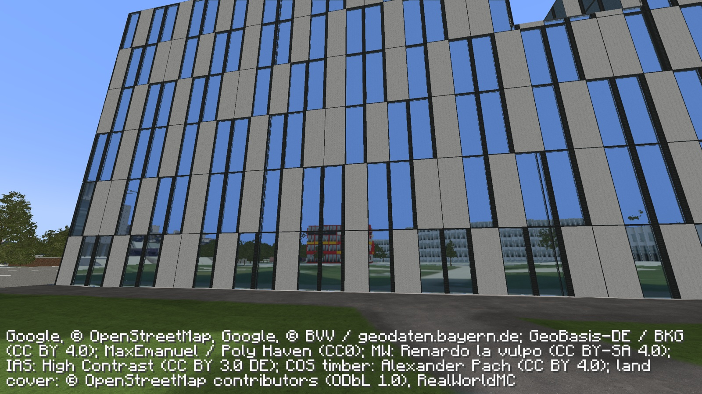

The panel/window system follows contractor and completed exterior photographs. Its 1.4 m modules, floor divisions and row sequences remain estimates; exact entrance and transparent ground-floor zones are unfinished. Contractor photographs are research references, not texture assets.

The earlier courtyard repair remains intact: about 681 m² of bounded terrain cut, retaining walls, 27 risers across five flights and a connected lower landing. Collision migration is now v25 and preserves ordinary player blocks and recorded edits. The existing one-metre proxy grid still approximates visual treads.

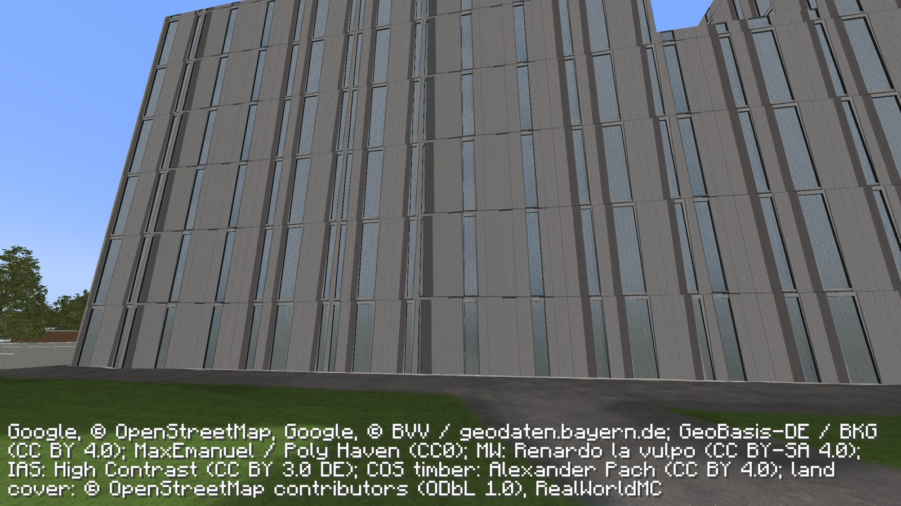

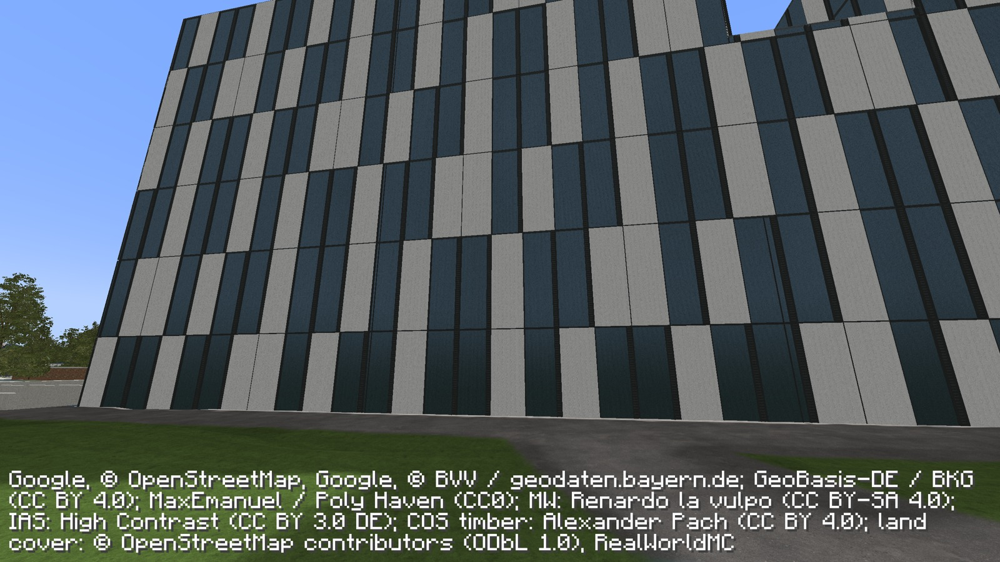

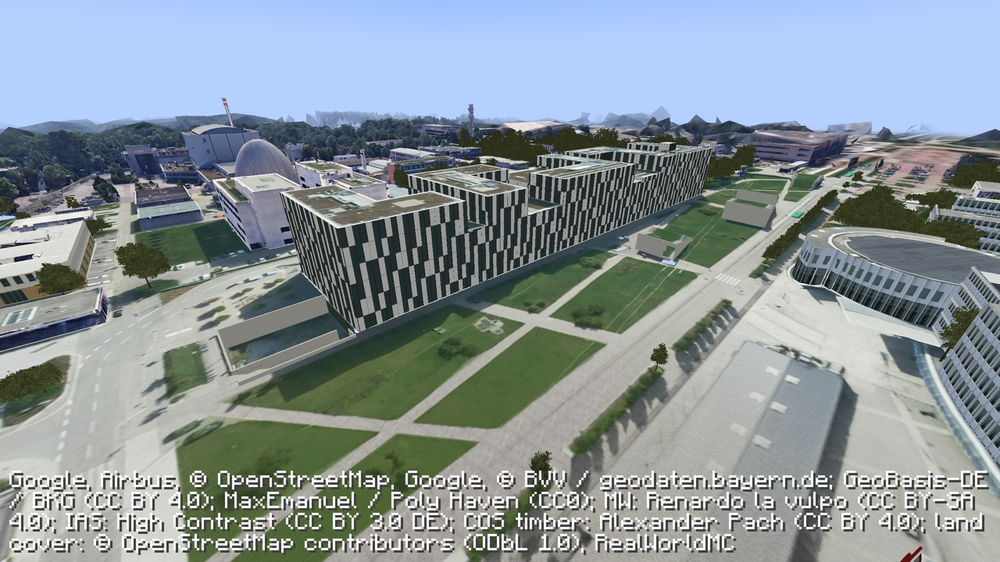

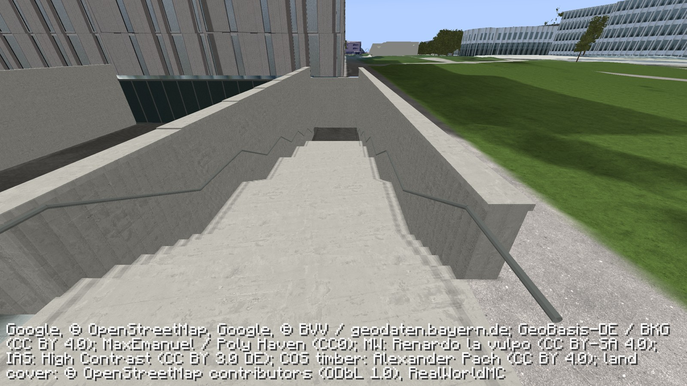

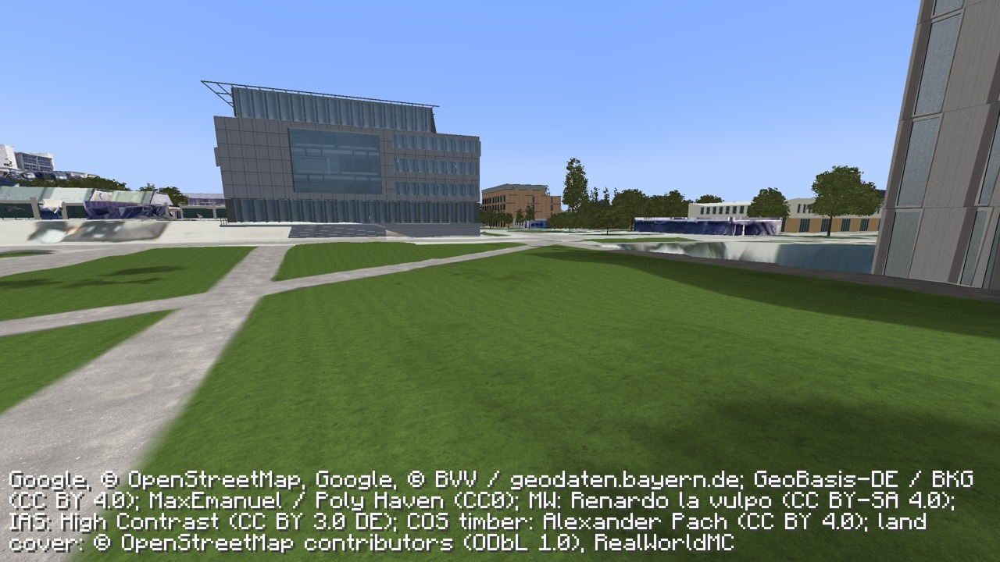

Pale margins around the sculpture and some junctions remain. Galileo’s former stretched bank is now reconstructed; courtyard landscaping and some facade-base joins still need work. Older aerial shading and approximate facade/reflection detail also remain unfinished.

Only map meshes cast and receive these new shadows. Vanilla blocks, players and mobs do not participate, and aerial images retain their baked shadows. One nearby Galileo facade plane reflects loaded map meshes; other glass uses the approximate sky/ground fallback. Vanilla blocks and entities are absent from these reflections. The reflected sky is a clear colour without clouds or stars, and only already-loaded tiles appear. Small sampling patterns can remain at thin edges, and shadows fade at the local map boundary. These are known limits of this preview.

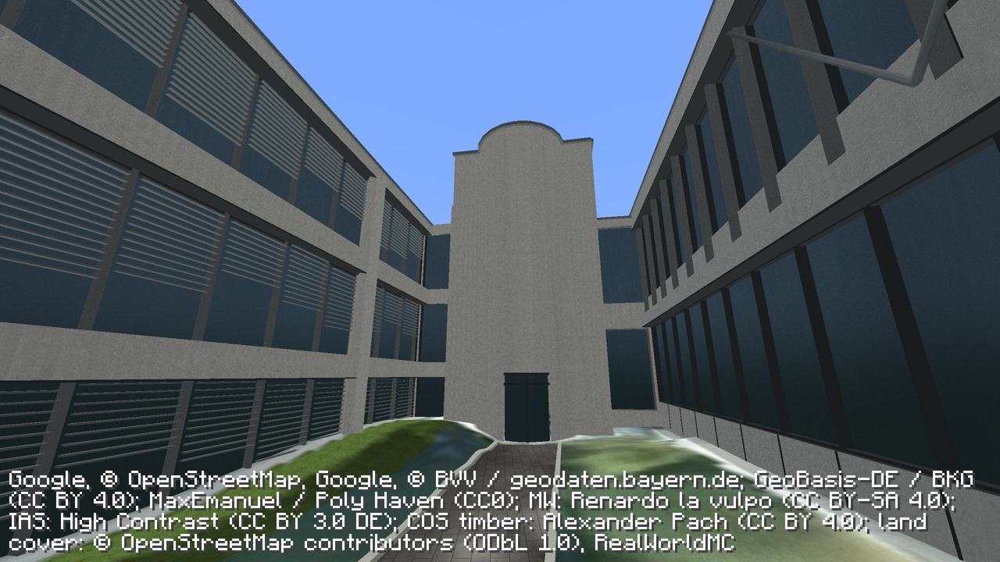

The broader visual-quality goal remains open. Functional checks establish playability of the tested cases, not completion of the campus reconstruction.
