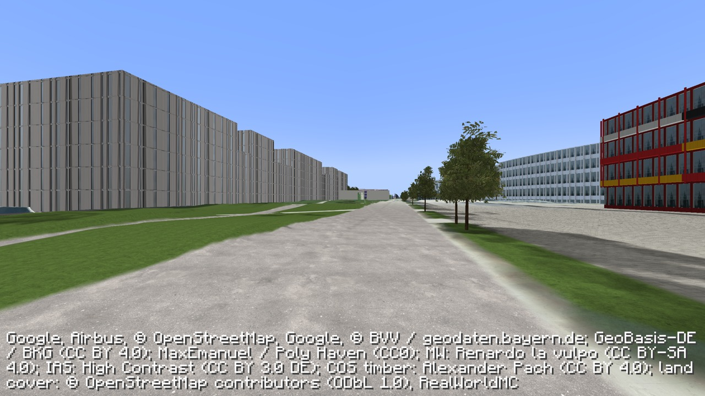

# Exterior Preview 0.5

This playable development snapshot adds the IAS exterior, survey-aligned photographic walls, the former Mensa terrace frontage and retaining walls, UYA's outer façades, UYE's east/north glazing, the masonry warehouse exterior, width-mapped road materials, the Telefonzentrale west end, the COS exterior, approximate finished-site grading, mapped site paving, benches, bicycle stands, an inferred planting bed, a smooth forecourt grade and the GRS north wing, stair tower, connecting bridges, repaired GRS II exterior and GRS III square wing/rounded tower, the small GRS II/III connector and a paved courtyard approach, survey-fitted tree crowns, mapped ground materials and full DGM1 terrain sampling. Four additional asphalt promenade corridors and smoother ground-material boundaries reduce blurry path margins. It also adds local mesh shadows that follow the sun, react to terrain damage, and turn off at night. It runs inside Minecraft Java 1.21.1 with the existing Minecampus add-on and Fabric setup.

The campus is still unfinished: several neighboring walls remain blurry, paths have inconsistent detail, and reconstructed window divisions/materials are approximate. Interiors are outside this pass. The public default installer remains on 0.4.0.

## Play the installed copy

On the development machine, restart the official Minecraft Launcher, open **Installations**, select **Minecampus — Exterior Preview 0.5**, and click **Play**. Open **Minecampus Garching** from Singleplayer. The copied world preserves inventory and edits as they stood when installed. Further progress belongs to this preview copy; the original **Minecampus — TUM Garching** installation remains separate.

Allow the map to finish streaming before judging geometry. The photographic façade pass can take several minutes on first entry. Existing local map credentials are reused; no new key is needed.

## Install the same snapshot alongside an existing setup

1. Quit Minecraft and its launcher.
2. Download `RealWorldMC-Minecampus-Exterior-0.5.0-dev-mc1.21.1.jar` from the [0.5 development preview release](https://github.com/DocMorphic/minecampus/releases/tag/exterior-0.5.0-dev.12) into this repository's `dist-minecraft/` directory.
3. On macOS/Linux, run `python3 scripts/install-exterior-preview.py` from the repository root. This requires the normal Minecampus installation and its map setup to exist already. It verifies the artifact hash, checks world locks, copies saves into a separate instance, verifies every copied save file, and adds the preview launcher profile. For an existing preview, use `python3 scripts/install-exterior-preview.py --update` instead. This verifies the recorded mod, refuses an open world, backs up the old mod, and replaces only that mod while verifying that saves and local settings stay unchanged.
4. Restart the launcher and follow the play instructions above.

The installer uses the current user's local map configuration, stored privately in the new instance. Credentials, saves, Minecraft assets and streamed provider imagery are absent from the public download.

## Evidence

The released JAR is the exact native-tested artifact: SHA-256 `12f61a528d022801cd652d41df18c1218bb338f25ed83af46e8d15a27bbee37e`. Thirty-seven route views pass 34 gameplay/geometry/material checks, with GPU lighting checks at every camera. Seven new GPU controls verify the four promenade paths and three former facade-base gaps. The 27 service tests and three updater tests also pass. See [the validation record](promenade-development-validation.json).

Four mapped asphalt paths add approximately 3,707 m² of detailed surface. Their widths and offsets are estimated from BVV's 20 cm orthophoto, separately from OSM's surface tags. Four samples per axis smooth diagonal material boundaries. All 97 render tiles, terrain and architecture guides remain unchanged; previous material interiors are preserved. The renderer classes and shaders remain byte-identical to dev.11, and collision migration remains v18. The earlier separate TNT, moving-sun, night and resource-reload evidence belongs to [dev.11](runtime-shadow-development-validation.json); it was not recaptured for this material-only change.

Short cross-paths still retain aerial surfaces. A lighter textured strip near the eastern facade remains from baked photographic shading. These areas need further source work and lighting treatment.

Only map meshes cast and receive these new shadows. Vanilla blocks, players and mobs do not participate, and aerial images retain their baked shadows. Glass still uses an approximate sky/ground reflection. Small sampling patterns can remain at thin edges, and shadows fade at the local map boundary. These are known limits of this preview.

The broader visual-quality goal remains open. Functional checks establish playability of the tested cases, not completion of the campus reconstruction.
