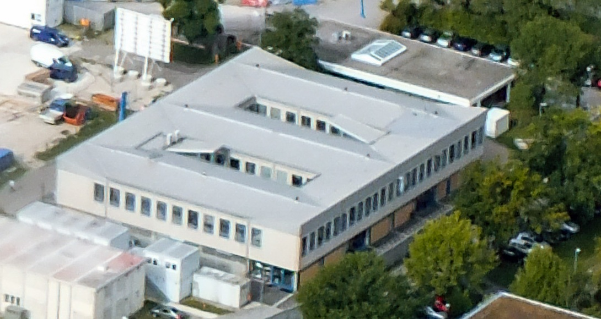
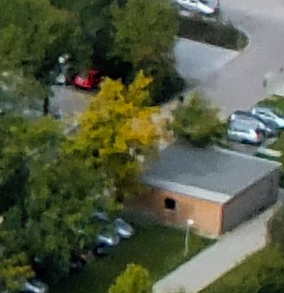

# Campus exterior quality work — 22 October 2026

The target is recognizable real Garching architecture inside Minecraft Java, with clear building silhouettes and textured vertical façades at walking height. An aerial-only screenshot is insufficient evidence. Interior reconstruction is out of scope; the Mensa approximation has been removed.

## Source comparison

- **Google Photorealistic 3D Tiles through the existing Cesium ion asset** remains the current source. It supplies full textured triangle meshes, including vertical surfaces, rather than extruding satellite imagery. Native-client captures must establish the finest source detail actually drawn; selecting more tiles alone is not proof of improvement.
- **Bavarian DOM-Mesh**, [official data notes](https://www.geodaten.bayern.de/odd/m/3/html/datenhinweise/datenhinweise_dommesh.html): 2.5D, derived from DOM20 and nadir aerial photographs. The provider explicitly lists soft roof edges, smeared façades, hanging trees and overlap artifacts. This is not an appropriate replacement for improved street-level façades. Its CC BY 4.0 licence is useful, but does not change those geometric limits.
- **Bavarian DOP20 / LoD2**, [official catalogue](https://geodaten.bayern.de/opengeodata/): orthophotos can improve overhead appearance; LoD2 provides cleaner building envelopes and roof forms. Neither supplies measured façade textures or façade detail by itself. Combining these would be a reconstruction, not a higher-resolution photographic survey.
- **TUM2TWIN**, [UAS mesh documentation](https://tum2t.win/datasets/cm-mesh): actual textured oblique/nadir photogrammetry, but of TUM's **Downtown campus**. It cannot be substituted for Garching.

## Native-renderer findings

Inspected RealWorldMC release source `6f18d1f3ba5a02dadee4b14bcb96578bf3941d13`, the v1.0.3 release commit. The map uses original decoded texture dimensions, trilinear mipmaps and up to 16× anisotropic filtering. Collision blocks are invisible; they do not explain coarse visible buildings. Tiles are drawn as textured triangles, and coarse parent tiles are retained until all replacement children arrive. Download order currently requests two ancestor levels before requested detail, with a 128-request queue cap. This makes loading/readiness an important measurement before changing source or adding shaders.

## Verification protocol

Use an isolated copy of the user's save. Keep the user save and credentials out of tracked files. Capture the user's last ground-level camera, an oblique aerial camera and additional recognisable landmarks. Keep identical cameras, source service and lighting between comparisons. Record renderer readiness and tile counts alongside frames. No claim of photographic street-level quality is warranted if the source itself lacks the required detail.

## Final selection and measured results

The fully loaded source scene reached approximately 3.6 million triangles with no pending requests; its ground-level defects remained. The local Google leaf geometry reports approximately 2 m geometric error, with no finer child. More requests cannot manufacture missing surface detail.

The release therefore combines DGM1 terrain, DOP20 imagery, two LoD2 Galileo components reconstructed using a CC0 façade reference, and three surveyed promenade roof structures. Official GCG2016 geoid heights align these meshes with the existing world. It retains Google's photographic mesh during elevated flight and uses the reconstruction near ground, with transition hysteresis. A nearest-child-first download experiment caused missing coverage and was rejected; the original coverage-first order remains. Snapping photographic walls to survey planes was also rejected after producing holes.

See [validation](VALIDATION.md) for the actual packaged Minecraft ground/aerial captures, walking, TNT and preservation checks. No source found in this research supplies an unrestricted, measured street-level scan of every Garching façade. Remaining scan artifacts are an explicit limitation.

## Walking-quality preview research

BVV DOM20 surface heights, paired with DGM1/DOP20, support inferred canopy locations and dimensions. The top-envelope check is conservative; it is not proof of exact tree trunk locations or species. All intersecting building envelopes are retained at the 600 m boundary. The near-ground outdoor layer is now supplied by survey/reconstructed assets, with building/roof footprints protecting the original architectural mesh.

Poly Haven supplies CC0 leaf/bark and concrete/grass colour/normal atlases. The installed game uses bundled copies, without live Poly Haven API calls. Source URLs and hashes are recorded in the vegetation/material manifests.

The [Graduate School architect reference](https://www.hkarchitekten.at/en/project/tum-exzellenzzentrum/) informs the building's projecting coloured bands and red supports. The architect's photographs are used as references and are not bundled. MW material/reference photography is the separately licensed Renardo la vulpo Commons image; its metadata describes the adaptation.

A public [KartaView location query](https://kartaview.org/doc/faq) for the campus with a 500 m radius returned an empty result in this research. This does not establish absence of imagery across the wider region. No KartaView imagery is bundled. It did not supply a replacement street-level campus scan.

A source backface-culling experiment did not resolve the outdoor fragment problem and was reverted. The final preview retains the source's two-sided rendering. Roof/overlap and outdoor classification repair, rather than more tile requests, are the relevant corrections. The unreconstructed source-façade inspection remains below the requested realism target.

## IAS exterior — 23 October 2026

The [architect's IAS project](https://fritsch-tschaidse.de/en/projects/tu-munich-institute-for-advanced-study.html) documents the raised terrace, glazed entrance storey, recessed terraces/atrium and expanded-metal cladding with folding sun screens. The [High Contrast photograph](https://commons.wikimedia.org/wiki/File:TU_M%C3%BCnchen_Garching_-_Institute_for_Advanced_Study.jpg), licensed CC BY 3.0 DE, supplies material crops and a south-façade reference. BVV component `DEBY_LOD2_8486677` supplies the measured outer envelope and roof form. Recess, stair and panel dimensions are reconstructed, not newly measured. The new native camera faces the IAS from the promenade and must be checked before claiming improvement.

## UYA exterior reference for the next façade pass

The coarse pilot façade `DEBY_LOD2_5284443` matches OSM way 23316555, named UYA. Its survey envelope is approximately 51 × 32 m with two narrow roof courts. The official [FRM II campus overview](https://indico.frm2.tum.de/event/444/attachments/944/1604/2022_FRM_II-Uebersicht_ueber_die_Gesamtanlage.pdf) identifies UYA as the Betriebs-/Laborgebäude. The [Bavarian building inventory](https://www.bayern.landtag.de/www/ElanTextAblage_WP18/Drucksachen/Schriftliche%20Anfragen/18_0007901.pdf) lists it as TUM 5209, built in 1965. The extract's OSM `ref=5213` conflicts with that official listing and is not used for identity.

[ESO's 2017 campus photograph](https://www.eso.org/public/ireland/images/170818035-cc/) provides a much clearer exterior reference than the streamed texture. The two roof courts and outer envelope match the survey; pale upper walls, individual window frames, glazed lower bays and tan lower panels are visible. The photograph predates the current scene and cannot establish later changes or hidden elevations.

Credit: **Ernst A. Graf/ESO**, [CC BY 4.0 under ESO's usage terms](https://www.eso.org/public/outreach/copyright/). Cropped for reference; not used as a runtime texture. [Pinned source, crop and identity metadata](photos/uya-eso-reference.json). Next work should fit the visible façade structure to the surveyed envelope, retaining the actual roof courts and distinguishing measured dimensions from inferred window detail.

## UYE exterior reference for the next pass

The [architect's UYE reception-building project](https://seifert-hugues.de/projekte/projekt-objekte/empfangsgebaeude-frm2.html&categorie=gewerbe-verwaltung) provides an exterior photograph showing a pale projecting flat-roof fascia and dark, horizontally divided glazing. The image filename identifies UYE and the project page dates completion to 2011. The photograph is reference-only: no open redistribution license has been established, so it is not committed or used as a runtime texture. [Pinned source metadata](photos/uye-architect-reference.json).

The project area is 160 square metres, whereas candidate BVV envelope `DEBY_LOD2_31360854` measures about 29.05 × 15.44 metres. The DOP20 roof footprint and skylight match the building behind UYA in the licensed ESO aerial. The 160 square metres may describe only the renovated part; it is not a complete glazing schedule. Development therefore replaces only the east/north elevations visible below the pale fascia in the aerial, using the architect photograph for materials and framing vocabulary. Pane divisions and recess depth are inferred. The other two elevations and the surveyed roof remain unchanged. No interior reconstruction is planned. The published 0.5 snapshot retains the preceding photographic treatment for this building.

## Path material coverage gap

The existing ground-material mask contains closed surface polygons, leaving many mapped linear paths on aerial imagery alone. A scan of the repository's OSM snapshot (2026-06-01, SHA-256 `4d0fc46fd780184c22567b47a00b0df701ae55c8d9b4bb460cc51bb08f422307`) found 411 road/path ways intersecting the 600 m campus after excluding explicit interiors, nonzero levels, tunnels and bridges. They include 173 asphalt, 100 paving-stone, 37 sett and 20 fine-gravel ways; 23 carry widths. These are candidate centre-lines, not measured surface boundaries or 411 verified ground-level paths.

[OSM surface tags](https://wiki.openstreetmap.org/wiki/Key:surface) distinguish material types. [Width](https://wiki.openstreetmap.org/wiki/Key:width) is a physical width, normally in metres; [area:highway](https://wiki.openstreetmap.org/wiki/Key:area:highway) provides mapped surface polygons where available. The next material pass should prefer polygons, then explicit-width lines, and check inferred boundaries against DOP20. Building footprints, water, raised walkways, stairs and lawns need exclusion/overlap checks. Fine gravel needs its own material rather than being treated as paving. This inventory is preparation; it does not claim new paths have already been rendered.

## Small warehouse exterior reference

The same [ESO aerial](https://www.eso.org/public/ireland/images/170818035-cc/) shows the small warehouse north of UYE, candidate `DEBY_LOD2_52738492`: a low rectangular building with a grey flat roof, pale edge and warm brick-coloured walls. One small dark opening is visible. The game camera approaches the opposite sides, so this reference does not establish their openings. [Crop metadata and limitations](photos/warehouse-eso-reference.json).

Credit: Ernst A. Graf/ESO, [CC BY 4.0](https://creativecommons.org/licenses/by/4.0/). Cropped from the original aerial; reference only, not a runtime texture.

### CALA apron follow-up source study

The61b walking captures still show a wavy street apron. Four ground-door profiles were compared with the actual encoded mesh and raw DGM1: the near-facade rise of roughly0.3-0.5m exists in the source elevation, so a rendering/seam defect alone does not explain it. No grade change has been made.

The [landscape architect project page](https://mahlgebhardkonzepte.de/projekt/cala-center-for-advanced-laser-application-lmu-garching/) describes the northern earth slope and planted roof. Its [street photograph](https://mahlgebhardkonzepte.de/wp-content/uploads/2024/06/IMG_1035-scaled.jpg) shows a sidewalk, rectangular paved entrance pads, planted wall strips and tree verges missing from the current asphalt-only approximation. The [landscape plan](https://mahlgebhardkonzepte.de/wp-content/uploads/2024/06/Plan-4.jpg) confirms differentiated paving/planting and graded levels; its raster labels were not used as exact threshold measurements. Any later south-apron grading must remain bounded, qualified and connected to the door thresholds, while preserving the measured northern berm. Reference pixels are not bundled.

## Central terrace material follow-up

The broader63 camera7 shows a large blurred photographic patch across the former Mensa terrace. TUM's [April2025 exterior photograph by Susanne Hoecht](https://www.ed.tum.de/en/ed/news-single-view-start/article/tum-ed-bezieht-alte-mensa-in-garching-nach-umbau/) visibly shows rectangular paving, tree/leaf-litter margins and a freestanding sculpture. It is reference-only, not bundled texture data. The raw BVV component `DEBY_LOD2_5284422` has a separate southern terrace roof surface (index10 in the pinned source),834.68m² at approximately MC Y67.41. The native lower-screen ray hits that surveyed photographic roof, identifying the material owner independently of the facade. Paving geometry, exact unit dimensions and sculpture reconstruction remain unimplemented; do not replace every low roof on this component with paving.

The [Galileo landscape architect](https://slam.green/projekt/galileo-neue-mitte-am-hochschulcampus-garching-muenchen/) describes aggregate-treated asphalt on the park connections and large concrete slabs in its courts. These are useful site-specific material references; they do not establish measured surface boundaries for the former Mensa.

The65 native comparison now verifies a material reconstruction on that named terrace:17 unchanged survey triangles use an original rectangular-paving atlas. The estimated0.2×0.1m units and4mm joints are qualified approximations. Other low roofs retain DOP pixels. Walking and aerial captures show the former smear removed. The run also measures a separate0.411m low native support; candidate66 introduces terrace-only fractional collision with unchanged render geometry. No sculpture or interior has been added. The current facade glass is analytically shaded but excluded from planar scene reflections; adding correctly oriented, bounded reflection selection is a further appearance task.

The67 follow-up traced three conspicuous ground smears in the completed central64 route (GRS north and two MLZ courtyard views) to actual ground tiles. At all three ray intersections the ground-material mask is `[0,0,0,255]`: no mapped lawn, paving, asphalt or soil material. Increasing material contrast alone would not replace those raw aerial pixels. The GRS DOP20 crop (EPSG:25832 bounds698375–698490 /5349475–5349590) shows parked vehicles, yard objects and long tree shadows north of the office wing. Surface composition and object types need further source checks before reconstruction. No new material region is inferred yet. The exact ray coordinates and source checksum are recorded in `ground-smear-followup.json`.
