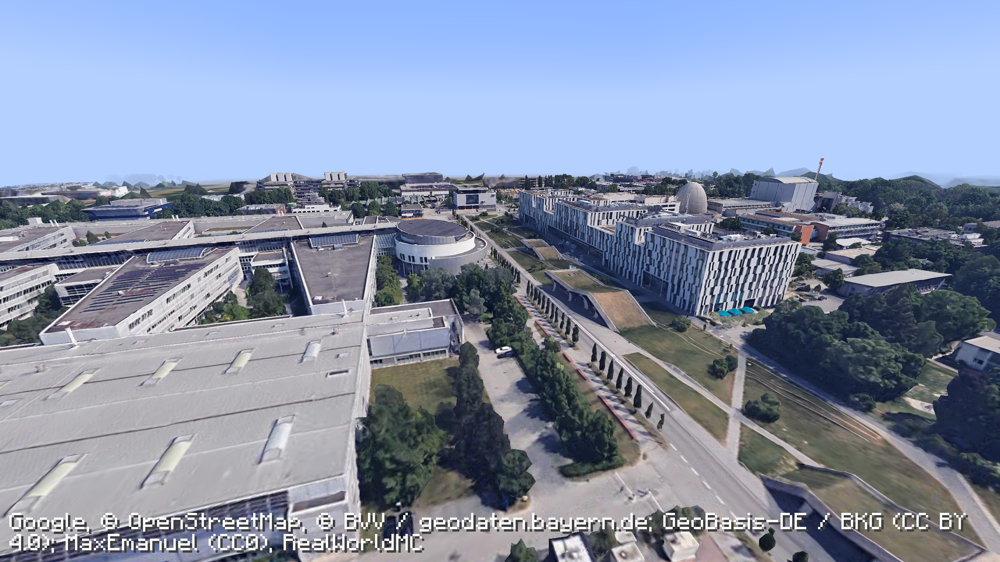
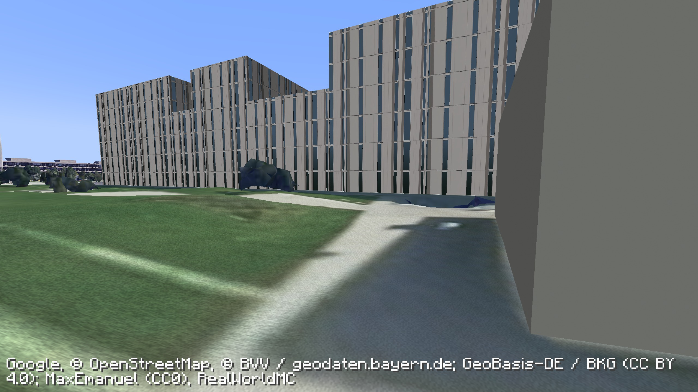
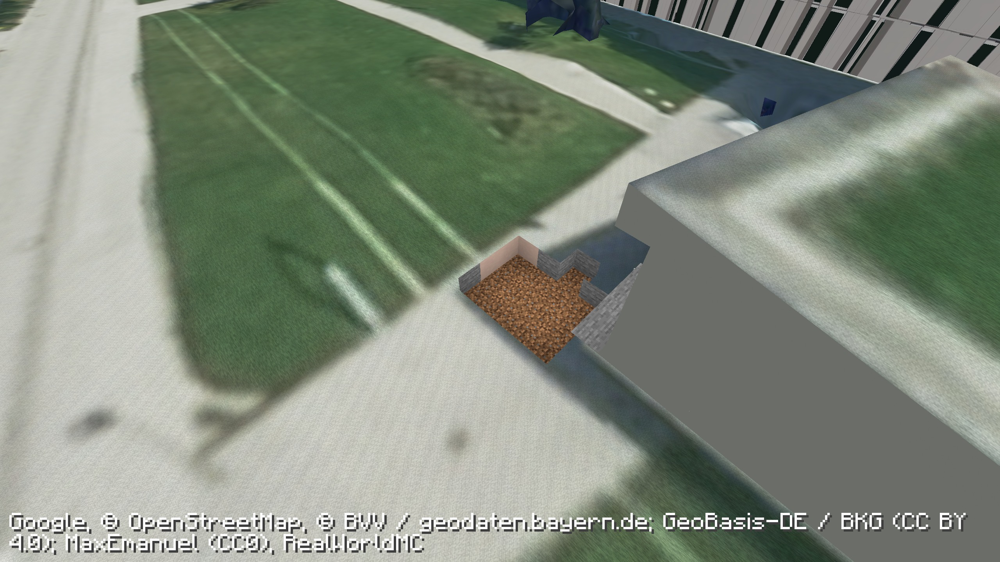

# Native exterior validation

Validated on macOS arm64 with Minecraft Java 1.21.1, Fabric Loader 0.19.5, Fabric API 0.116.17+1.21.1, JDK 21 and Node.js 22.23.3.

## Evidence

The release JAR was loaded as a mod dependency in a separate Fabric client project, without the development RealWorldMC classes. Its own embedded Node service was extracted and started through the managed runtime. Provider credentials were copied only into an ignored private test directory. A copy of the campus save was used throughout.

The client waits for zero pending tile-tree expansions, all requested tiles loaded, and a complete displayed view before capturing. Test assertions are checked independently of the Java process's exit status; a missing or failed result fails Gradle.

- **Rendering:** ground, elevated flight and post-explosion native framebuffer captures completed.
- **World preservation:** an ordinary diamond block and an explicitly recorded excavation survived collision migration; the migration added no player-damage records. An initial cold migration aligned 15,469 proxy blocks. Repeated migration in the packaged build made no additional changes.
- **TNT:** a real `PrimedTnt` entity excavated the surveyed terrain and recorded damage. Its original block states were then restored in the isolated test save.
- **Walking:** the player fell under Minecraft gravity and landed on the corrected surface at Y = 65.0.
- **Geometry:** 41 render tiles, 224,331 added triangles and 40,508,316 texture bytes pass binary-length, finite-coordinate, UV-range and bounds checks.
- **Installer:** integrity/importability, preserved profiles/world files/credentials, and safe retirement of old owned mod JARs are covered by the native pack tests.

The test scene temporarily fixes daylight/weather and disables mob spawning. Existing recorded edits are restored only in the isolated clean-scene copy. Test fixtures are removed after their preservation assertions. These scene controls are not installed into the user's original save.

### Packaged Minecraft captures

## Scope and limits

The source comparison confirmed that local Google leaf tiles have approximately 2 m geometric error. Raising detail settings to a fully loaded 3.6-million-triangle scene did not repair the melted walking-height surfaces. The open-data reconstruction adds targeted detail; it does not turn the entire source scan into a measured street-level digital twin.

Only the two Galileo components and three promenade structures are reconstructed. The 106 building guides in the preparation manifest are source coverage/provenance, not 106 finished detailed buildings. Window repetition, material reflection and close ground grain are reconstruction/rendering choices. The official geoid grid aligns survey heights with the streamed mesh; it does not improve the source survey's own accuracy.

Two-client LAN, optional shader-pack interoperability and scanned interiors are outside these validation results. Night still shades imagery captured during daylight.
