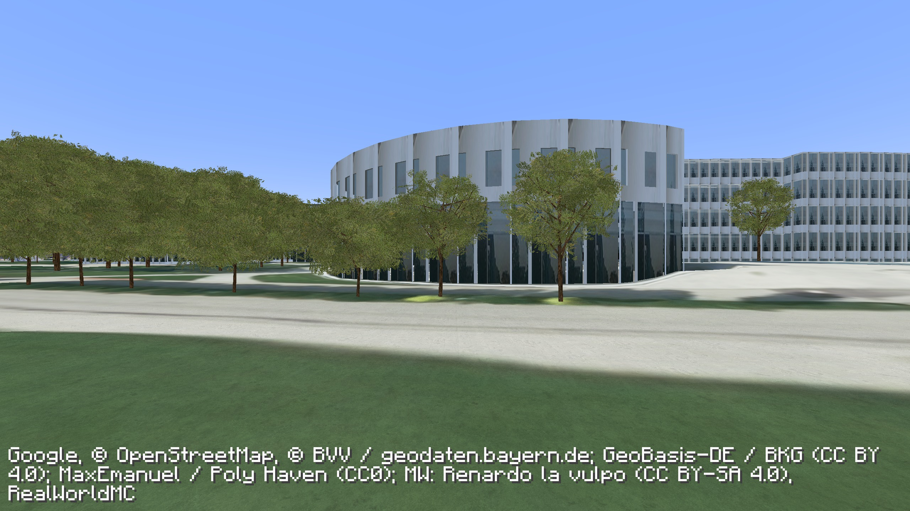
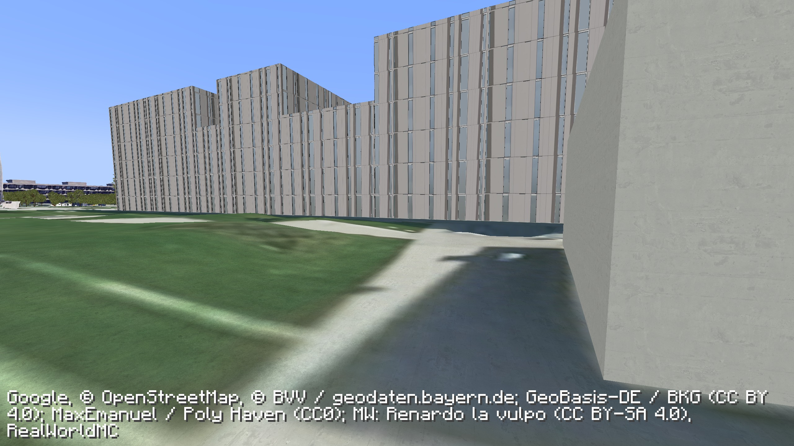
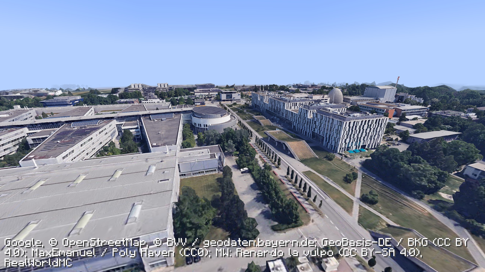
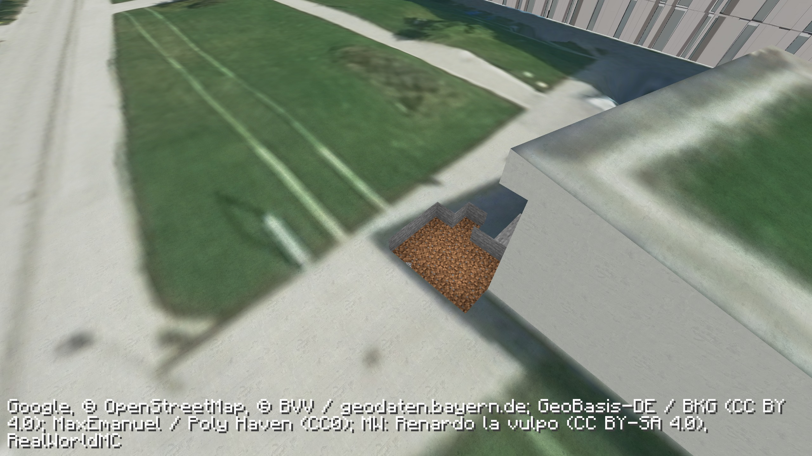
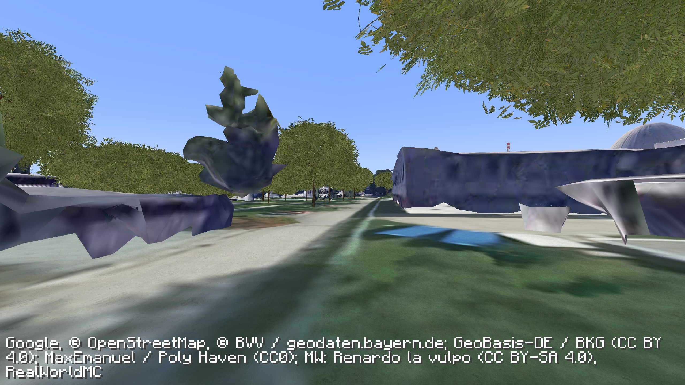

# Walking-quality preview validation — 0.4.0

**The realism goal remains unfinished.** This preview improves selected central walking routes. Substantial artifacts remain on unreconstructed photographic façades.

## Exact packaged game

Minecraft Java 1.21.1, Fabric Loader 0.19.5, Fabric API 0.116.17+1.21.1, JDK 21 and Node.js 22.23.3 on macOS arm64. The final release JAR was loaded as a mod dependency in an isolated Fabric client, without development RealWorldMC classes. Its embedded Node service started through the managed runtime. Credentials stayed in ignored local configuration. Testing used a separate copy of the save.

Seven native framebuffer captures waited for zero pending expansions, all requested tiles loaded and a stable complete view. Missing or failed assertion files fail the check independently of Minecraft's exit code.

- Ground, aerial, TNT and three promenade routes plus a source-limit view were captured.
- A player diamond block and recorded excavation survived migration; migration added no damage records. The final check aligned 81 proxies.
- Native primed TNT excavated the surveyed mesh. Test damage was then restored. The player fell under gravity and landed at Y = 65.0.
- 81 render tiles, 1,500,384 triangles and 240,760,448 texture bytes passed binary, finite-coordinate, UV and bounds validation.
- 117 source building guides protect coverage; only six building components and three landscape structures receive detailed reconstruction. There are 734 inferred canopy instances across 36 groups.
- Twelve service tests and three native-pack installer tests passed, including preservation and integrity checks.

The original save, its inventory and recorded edits were preserved. A separate local Ground Detail 0.4 save uses clean tested terrain and the original inventory. Test-only fixed daylight and disabled mob spawning were not copied into its game rules.

## Actual Minecraft captures

### Remaining source quality — not fixed

Functional checks do not establish photorealism. Window repetition, roof simplification, inferred trees and photographic/analytic glazing are reconstruction choices. Leaf cards do not implement full native leaf-block behaviour. Building-attached scan fragments and missing outdoor props remain. Night shades daylight imagery; interiors, two-client LAN and optional shader packs are outside this validation. See [the unfinished quality goal](QUALITY-GOAL.md).

Release checksums, counts and assertion results are recorded in [validation.json](validation.json). Full-frame captures retain provider attribution.
