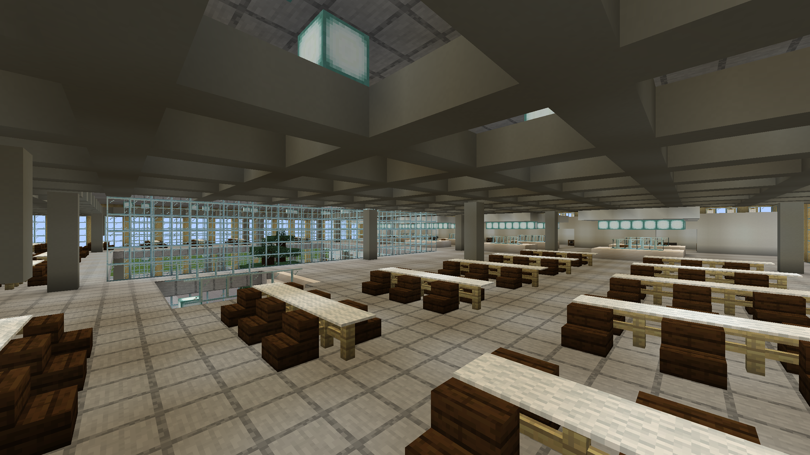

# Validation — 21 October 2026

The generated structure and datapack were tested using native Minecraft Java 1.21.1, Fabric Loader 0.19.5 and Fabric API 0.116.17+1.21.1, in an isolated RealWorldMC development checkout on macOS arm64 with Java 21.

- **PASS:** Minecraft loads the template and places it using its own `/place template` command.
- **PASS:** the study dimension and all seven datapack functions register.
- **PASS:** entrance door and pressure-plate states, stair material/headroom, open courtyard roof and covered dining roof.
- **PASS:** a real Minecraft barrel reads the supplied 1.21 food-item NBT with 32 items.
- **PASS:** a player-sized collision box fits at seven representative approach/interior points, including the opened entry, foyer, landing, dining aisle, café aisle and courtyard.
- **PASS:** visit/back functions transfer the player between dimensions and retain their individual coordinates and camera direction.
- **PASS:** a hidden native Minecraft client opens a copied test save and renders four views; images were visually inspected. The dining-hall lighting was adjusted after that review, then the native checks and captures were repeated.
- **PASS:** final datapack installed into the existing `Minecampus Garching` save's datapacks directory. Existing campus chunks and local map credentials were not modified.

The captures use actual Minecraft rendering and vanilla assets, without a shader pack. They show an architectural block reconstruction, not photorealistic rendering. Camera placement is automated, not a human walking playtest. The checks do not prove multiplayer operation, all possible routes/interactions, or real-building fidelity beyond the documented source references. Seamless replacement of the campus scan is not part of this first preview.

See [reproducible native test instructions](gametest/README.md).
